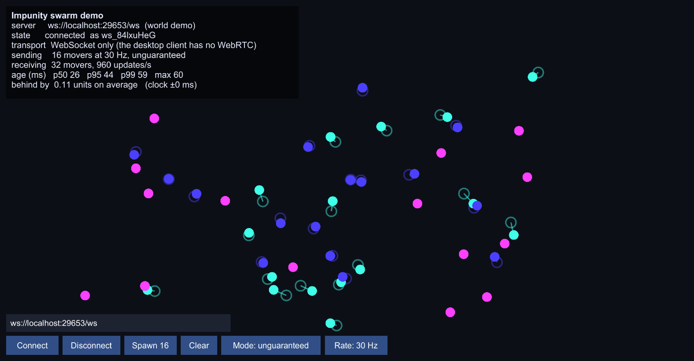

# Swarm demo

A small end-to-end client for seeing Impunity's unguaranteed delivery work, and for measuring it. It lives in
`Assets/Scripts/Demo/` and runs in `Assets/Scenes/TestGameScene.unity`, in the editor, as a macOS build, and as a
WebGL build in a browser.

Each client spawns a handful of fast-moving sprites ("movers") and reports their positions to the server many
times a second as unguaranteed updates. Every other client draws them where they were last reported. Beside each
remote sprite is a faint ring showing where it really is at this moment, joined to it by a line. **The length of
that line is the network's delay**, and the panel in the corner puts numbers on it.



*The editor's view of three clients. Pink sprites are its own; the others belong to a browser and a macOS build,
each with the ring and line showing how far its last report is behind.*

The ring is possible because a mover follows a fixed curve against the shared server clock. The curve is sent
once, reliably, when the mover is created; after that any client can work out the true position for itself and
compare it with the last one it was sent.

All paths and commands below are relative to `ImpunityUnity/`.

## Running it

```bash
tools/demo-server            # a standalone server: tcp://127.0.0.1:29654, ws://localhost:29653/ws, world "demo"
tools/demo-server --web      # the same, and serve the WebGL build at http://localhost:8080/
```

The server starts with an empty world every time (its state is in `Temp/demo-server`).

**In the editor:** open TestGameScene, press Play, press Connect, press Spawn 16. Or from a shell:

```bash
tools/ucmd play
tools/ucmd game demo connect            # tcp://127.0.0.1:29654 unless told otherwise
tools/ucmd game demo spawn 16
tools/ucmd status                       # the demo's numbers are under "game"
tools/ucmd shot
```

**In a browser:** build once, then open the page with the server to connect to in the address:

```bash
tools/demo-build webgl
tools/demo-server --web
# http://localhost:8080/?server=ws://localhost:29653/ws&spawn=16
```

**As a macOS app:** `tools/demo-build mac`, then
`Builds/Mac/ImpunityDemo.app/Contents/MacOS/Impunity -server tcp://127.0.0.1:29654 -spawn 16`.

Two clients are needed to see anything interesting: a client draws its own movers exactly where they are, and
only shows rings, lines and statistics for other clients' movers.

## Controls

The same settings can be changed from the buttons, the dev console (backquote opens it; `tools/ucmd game …`
reaches it from a shell), the command line of a desktop build, or the page address of a WebGL build.

| Button | Console | Start-up argument | Does |
|---|---|---|---|
| Connect (with the address field) | `demo connect [url] [world] [password]` | `server`, `world`, `password` | Connects and joins the arena. `tcp://host:29654`, `ws://host:29653/ws` or `wss://…`. |
| Disconnect | `demo disconnect` | | Closes the connection. The server deletes this client's movers. |
| Spawn 16 | `demo spawn <count>` | `spawn` | Adds movers owned by this client. |
| Clear | `demo clear` | | Deletes this client's movers. |
| Mode | `demo mode unguaranteed\|guaranteed` | `mode` | How this client sends positions: `SetUnguaranteed`, or `Set` for comparison. |
| Rate | `demo rate <hz>` | `rate` | Position reports per second per mover (the frame rate is the ceiling). |
| | `demo status` | | State and statistics as one line of JSON. |

Start-up arguments are `-name value` on a command line and `?name=value&…` in a page address.

## Reading the panel

| Line | Meaning |
|---|---|
| transport | The wires in use right now. `TCP + UDP` or `WebSocket + WebRTC data channel` mean unguaranteed updates are leaving as datagrams. `TCP only`, `WebSocket only` mean they are being sent reliably instead. This can change while connected. |
| sending | This client's movers, its report rate and mode. |
| receiving | Other clients' movers, and how many of their position updates arrived per second. |
| age (ms) | How old a position was when it was applied here, over the last three seconds: median, 95th and 99th percentile, and worst. It includes the sender waiting for its next frame, both network hops, and this client waiting for its next frame. |
| behind by | Average distance between where a mover was reported and where it really was, in world units. |

The age relies on both clients' estimates of the server clock, so a few milliseconds of it is clock error rather
than delay. The tail (p95, p99, max) is the part that matters: a healthy datagram path keeps it close to the
median, while a reliable path under packet loss shows spikes each time a lost packet holds up the ones behind it.

## Driving a WebGL build

A browser page can't host the Pipeline server that `tools/ucmd` talks to, so the WebGL build has its own small
bridge (`DemoWebBridge.cs`, `Assets/Plugins/ImpunityDemo.jslib`). From the page's JavaScript console, or a tool
that can run JavaScript in the page:

```js
impunityDemo.status                       // state, transport and statistics, refreshed four times a second
impunityDemo.run("demo spawn 16")         // any dev-console line
impunityDemo.run("net server conns")
impunityDemo.results                      // [{ command, output, failed }, ...] newest last
```

## How it is built

| File | What |
|---|---|
| `Assets/Scripts/Demo/DemoEntities.cs` | The replicated types: `DemoArena` (the one channel), `DemoMover` (an object with an `Orbit`, set once, and a `Motion`, the latest position report), and the two small serializers. Movers are client-authoritative and delete-on-disconnect. |
| `Assets/Scripts/Demo/DemoGame.cs` | Everything else: the connection, spawning, the send loop, the views, the statistics, the panel and buttons (built in code, so the scene only holds the component), and the `demo` console group. |
| `Assets/Scripts/Demo/DemoWebBridge.cs`, `Assets/Plugins/ImpunityDemo.jslib` | Start-up arguments, and the page bridge for WebGL. |
| `tools/demo-server`, `tools/demo-build` | The server and build scripts above. |

The client's `ImpunityOptions.GameTypeCode` must match the server's `game_type_code` (`ImpDemo`): the UDP
negotiation beside a TCP connection uses it, and a mismatch silently leaves the connection on TCP alone.
