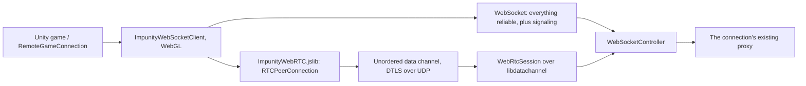

# WebRTC transport for Unity WebGL

Status: design, revised 2026-11-12 after a review against the code. Stage A (the shared-runtime fixes in
section 2) is implemented; nothing WebRTC-specific is. Section 11 records
what a throwaway spike proved and what is still unproven. This revision replaces the original proposal, which is kept
beside it as [WebRtcTransport.original.md](WebRtcTransport.original.md) for reference.

## 1. Goal and verdict

Browser games can only reach Impunity over WebSocket, so `SetUnguaranteed` state (movement, aim) waits behind
every lost TCP segment. The goal is UDP-style delivery for that state in a Unity WebGL build.

The approach: keep the WebSocket as the connection, and add one optional WebRTC data channel beside it for
unguaranteed entity updates. The standalone server terminates every peer connection with
[libdatachannel](https://github.com/paullouisageneau/libdatachannel) and keeps relaying through the existing
channel subscriptions. Clients never connect to each other. If WebRTC is unavailable for any reason, the
connection carries on over WebSocket exactly as today.

This is feasible. The alternatives were checked and do not work today:

| Alternative | Why not |
| --- | --- |
| SIPSorcery (pure C#, no native code) | Its SCTP has no partial reliability and no unordered sends: `FORWARD-TSN` is commented out of the chunk enum and `SctpDataSender` retransmits without limit. A channel opened with `maxRetransmits: 0` would behave reliably. |
| WebTransport on Kestrel | Still a preview feature in .NET 10, and datagrams are not implemented. Worth revisiting when they are: Safari has shipped WebTransport since 26.4. |
| DataChannelDotnet (NuGet wrapper) | Could not confirm which native platforms it ships. Impunity needs about twenty C functions, so it owns a small P/Invoke layer instead. |

What this buys, stated plainly: a later update no longer waits for the retransmission of an earlier one. It is
still SCTP over DTLS with congestion control, not raw UDP, and it promises no delivery time.

Out of scope for the first version: replacing the WebSocket, native (non-browser) WebRTC clients, peer-to-peer,
audio/video, TURN hosting, reliable data channels, and application-level fragmentation.

## 2. Bugs in today's code that this work must fix first

These were found while reviewing the proposal. They affected the existing TCP+UDP transport, and a second
unordered path would have made each of them worse. **All four are now fixed** in the shared runtime, with
regression tests (`--filter "Category=Sequence|Category=Unguaranteed"`).

1. **Unguaranteed intent is lost at the server.** `GameStateActionBase.Guaranteed` is `[BsonIgnore]` and defaults
   to true; `ImpunityServer.ClientMessageReceived` never sets it. An update that arrived over UDP is relayed to
   every listener reliably, so UDP only helps the upstream hop.
   *Fix:* a header flag, `ImpunityMessageFlags.UNGUARANTEED = 2`, set by the sender from the action's delivery
   class regardless of which path carries it. The server honours it only for `UpdateEntityAction`.
2. **Stale fields are relayed.** `GameStateEntity.UpdateProps` (`GameStateLive.cs`) skips a field whose sequence
   is stale, but the channel and object overrides relay the original `propData` under a fresh `OutSeq`. Listeners
   accept bytes the server itself rejected.
   *Fix:* relay only the accepted fields (copy their byte ranges into a scratch buffer); stamp `LastModSeq` only
   for those; send nothing if every field was rejected.
3. **16-bit sequence wrap drops valid writes.** `SendSeq` is a per-entity `ushort` bumped on every update, and
   freshness is `(short)(seq - RecvSeq[propId]) > 0`. A field untouched for 32,768 updates of its entity (about
   nine minutes of 60 Hz movement) has its next write rejected as stale. This hits guaranteed writes too.
   *Fix:* widen `Seq`, `SendSeq`, `OutSeq`, `RecvSeq`, `LastModSeq`, `FieldRecvSeq` and the known-field-seq blob
   to `uint`, compared with a signed 32-bit difference (`ImpunityUtil.SeqIsNewer`). The wire cost is two more
   bytes per field in guard blobs, plus whatever BSON spends on a wider integer in each update. At 60 Hz the
   window is over a year per entity.
4. **No size limit on unguaranteed sends.** Anything under 65,000 bytes goes to UDP.
   *Fix:* both ends send an unguaranteed message reliably when it exceeds the transport's limit (section 5).

All four change the wire or its meaning, so `ImpunityConstants.ImpunityVersion` went from 1 to 2. There is no
capability negotiation and no legacy path: the project does not keep backward compatibility before a game ships.

## 3. Architecture



The WebRTC session is a private detail of the WebSocket transport on both ends, the same way the UDP socket is
a private detail of `ImpunityTCPClient` and `ImpunityNetworkTCPServer` today. One browser has one proxy, one
connection id, one world authorization. Nothing above the transport knows WebRTC exists; it sees
`SupportsUnguaranteed` turn true and later, perhaps, false again.

The transport interfaces already fit:

- `SupportsUnguaranteed` is already dynamic. The TCP transports flip it when the UDP ping/pong completes.
- `IImpunityNetworkServerClientContext` already allows an unguaranteed send while a reliable write is in flight.
- `ServerSideNetworkConnectionProxy.QueueMessage` already routes on `SupportsUnguaranteed` per message.

One member is added to each transport interface: `MaxUnguaranteedMessageBytes`. `QueueMessage` and
`RemoteGameConnection` send anything larger through the reliable path.

Standalone-only classes, outside the glob of shared server sources:

| Class | Responsibility |
| --- | --- |
| `LibDataChannelNative` | P/Invoke for the pinned C API, native loading, callback lifetime. |
| `WebRtcService` | Loads the library once, owns configuration and the peer limit, creates sessions. Singleton. |
| `WebRtcSession` | One peer connection and one data channel, owned by one `WebSocketController`. |

## 4. Signaling

Signaling uses **WebSocket text frames on the existing socket**. Impunity messages are binary frames; the
jslib already ignores anything that is not an `ArrayBuffer`, and `WebSocketController` can branch on
`WebSocketMessageType.Text`. Text frames never reach `OnMessageRecieved`, so the action protocol,
`RemoteGameConnection` and the proxy are untouched.

```text
browser                                        server
  |-- text {"t":"offer","sdp":"..."} ----------->|   create peer, set remote description
  |<- text {"t":"answer","sdp":"..."} -----------|   answer includes the server's candidates
  |          or {"t":"unavailable","r":"..."}    |
  |== ICE / DTLS / SCTP over UDP ================|
  |   data channel "open" on each side           |   each side sets SupportsUnguaranteed = true
```

Rules:

- The browser is always the offerer and creates the channel:
  `createDataChannel("impunity", { ordered: false, maxRetransmits: 0 })`. The server accepts exactly one
  incoming channel and checks it is unordered with zero retransmits; anything else closes the peer.
- **No trickle ICE and no browser candidates.** The browser sends its offer as soon as `setLocalDescription`
  resolves. The server removes any `a=candidate` lines from the offer and learns the browser's address as a
  peer-reflexive candidate when the browser's first connectivity check arrives. Browser host candidates are
  mDNS names a remote server could not resolve anyway, and this way the server never sends a packet to an
  address that did not contact it first, so no candidate address policy is needed.
- The server gathers only local candidates, which is immediate, and returns the complete answer in one frame.
- There is no activation handshake. A data channel opens only after ICE, DTLS and SCTP have all succeeded in
  both directions, so each side starts sending on its own `open` event and stops on `close` or `error`.
- There is no per-packet envelope. One data-channel message is one complete Impunity frame (12-byte header and
  BSON body). The channel belongs to one DTLS session owned by one WebSocket; a retry is a new peer object.
- The browser starts as soon as the WebSocket opens, in parallel with the Impunity handshake. `Connect` never
  waits for WebRTC.
- Server-side text sends share the socket with the proxy's reliable writes, and `WebSocket.SendAsync` must not
  run concurrently. `WebSocketController` takes a `SemaphoreSlim` around every socket send. Reliable writes are
  already serialized by the proxy, so the lock is only ever contended by the one answer frame.

Limits: one peer per WebSocket at a time; offers over 16 KiB are refused; a second offer while one is pending
is refused; a process-wide `max_peers`. A socket that never completes the Impunity handshake is closed by the
existing 2.5-second establish timeout, which takes its peer with it.

Trust is unchanged from the original proposal. The browser trusts the page's HTTPS/WSS endpoint; the offer and
answer travel over that socket and carry the DTLS certificate fingerprints; each DTLS stack verifies its peer
against them. libdatachannel and the browser generate their own self-signed certificates. No public certificate
is provisioned for WebRTC, and fingerprint verification is never disabled.

## 5. Sending, receiving and limits

| Message | Path |
| --- | --- |
| Guaranteed, or not an entity update | WebSocket. |
| Unguaranteed, channel not open | WebSocket (existing fallback). |
| Unguaranteed, larger than `MaxUnguaranteedMessageBytes` | WebSocket. |
| Unguaranteed, channel open, send buffer under budget | Data channel. |
| Unguaranteed, channel open, send buffer over budget | Dropped. |

- `MaxUnguaranteedMessageBytes` is 1,200 for WebRTC and for the existing UDP transport. This is a conservative
  budget for one unfragmented packet, to be checked against real movement payloads.
- Send budget: skip the send when `bufferedAmount` (browser) or `rtcGetBufferedAmount` (server) is above
  16 KiB. `maxRetransmits: 0` stops retransmission but not queueing, and stale movement is worth less than no
  movement. Dropping a whole unguaranteed update is within its contract.
- The server never falls back to the WebSocket from inside `SendUnguaranteedMessageAsync`; the choice was made
  in `QueueMessage` before the call. A send that fails after that is dropped.
- Encode-once fan-out is unchanged: with no envelope, every recipient gets the same shared array.
- Received data-channel messages go to the same `OnMessageRecieved` handler as WebSocket messages, after a
  check that the declared frame length equals the message length. On the server only `UpdateEntityAction` is
  accepted from the data channel; anything else is dropped and logged.
- A data-channel receive does not refresh the proxy's reliable keepalive timestamp. Otherwise a dead WebSocket
  could be held open by movement packets. (The existing UDP path refreshes it today; it gets the same fix.)

Ordering across the two paths is not preserved. An update can overtake the reliable message that creates its
entity, or arrive after the one that deletes it. Both ends already drop updates for unknown entities, and the
per-field sequence check (section 2, fix 3) stops an old value replacing a newer one. Games should send
unguaranteed state as complete replacement values and finish a motion with one guaranteed update.

## 6. Liveness and retry

- When the channel has carried nothing for one second, each side sends the existing header-only `KEEPALIVE`
  frame over it. If a side receives nothing on the channel for five seconds, it closes the peer and sets
  `SupportsUnguaranteed` to false; later unguaranteed sends use the WebSocket.
- A peer `failed`/`closed` state or a channel `close`/`error` does the same immediately.
- The browser retries once, 30 seconds after a failure, with a new peer. It does not retry after
  `unavailable`.
- Losing the WebSocket tears down the peer. Losing the peer never reports `OnNetworkError`.
- `Dispose()` closes both without reporting an error.

The game can read `SupportsUnguaranteed` on its connection to show or log which mode it is in.

## 7. Unity WebGL bridge

`ImpunityWebRTC.jslib` sits beside `ImpunityWebSocket.jslib` and shares its instance registry, because the peer
needs its instance's WebSocket for signaling. The WebGL `ImpunityWebSocketClient` drives it.

- All signaling happens in JavaScript. C# receives only `open`, `close(reason)` and binary messages.
- Feature-detect `RTCPeerConnection`, wrap construction in `try`, and catch every rejected promise. Any failure
  is "stay on WebSocket".
- `binaryType = "arraybuffer"`. Copy received bytes into `_malloc` memory, call the managed callback, free in
  `finally`, as the WebSocket bridge does.
- Sends must honour `ArraySegment.Offset`; the existing WebSocket interop passes only array and count.
- Copy outbound bytes out of the WASM heap before the call returns. Never hold a `HEAPU8` view across an
  `await` or memory growth.
- Late promise completions and events check that their instance still exists and still owns that peer.
- Add a `wss://` factory overload; `MakeWebSocketClient` hardcodes `ws://` today, which a page served over
  HTTPS cannot use.

## 8. Server native library

Use libdatachannel's C API (`rtc.h`) with the libjuice ICE backend. Pin one release and its submodules.

Loading must only ever disable WebRTC:

1. HTTP, WebSocket and TCP start first, independently.
2. `WebRtcService` resolves the library from an absolute path under the application folder for the current
   **process** architecture, with `NativeLibrary.TryLoad`. No static initializers or DI constructors that throw.
3. It creates and deletes one peer as a smoke test, then marks itself available.
4. Any failure logs one line saying why, and every offer is answered `unavailable`.

Interop rules: keep delegates and user-pointer handles alive until the native object is deleted; copy callback
payloads before returning; catch every managed exception at the boundary; never hold a lock across a native
call that can call back; never delete a peer from inside one of its callbacks. Callbacks only enqueue.

Peer configuration: `enableIceUdpMux = true` with `portRangeBegin == portRangeEnd` so every peer shares one UDP
port; no ICE servers; ICE-TCP off; `disableAutoNegotiation` left off so the answer is produced by
`rtcSetRemoteDescription`.

### Build and packaging

No trustworthy prebuilt set covers all four platforms, so Impunity builds them. One script,
`native/libdatachannel/build.sh`, builds the library for whatever platform it runs on; the workflow
`.github/workflows/native-libdatachannel.yml` runs it on each platform, and the outputs are **committed to the
repository**, as `UltraLiteDB.dll` is, so `build.sh` and `./test.sh` need no network or toolchain.

| Target | RID | Runner | Artifact | State |
| --- | --- | --- | --- | --- |
| macOS arm64 | `osx-arm64` | `macos-15` | `libdatachannel.dylib` | Built locally and browser-tested. |
| Linux arm64 | `linux-arm64` | `ubuntu-22.04-arm` | `libdatachannel.so` | Not built yet: needs a workflow run. |
| Linux x64 | `linux-x64` | `ubuntu-22.04` | `libdatachannel.so` | Not built yet: needs a workflow run. |
| Windows x64 | `win-x64` | `windows-2022` | `datachannel.dll` | Built and smoke-tested by the workflow; not committed until all four legs pass. |

- Location: `ImpunityStandaloneServer/runtimes/<rid>/native/`, each with a `libdatachannel.manifest.json` giving
  the pinned tags and commits, build flags, dependencies, platform floor and the file's SHA-256.
- Pins: libdatachannel v0.24.6 and Mbed TLS v3.6.7, each by tag and commit. The script refuses a tag that no
  longer points at the pinned commit.
- One shared library per platform with libjuice, usrsctp and the TLS library linked statically:
  `-DNO_MEDIA=ON -DNO_WEBSOCKET=ON -DNO_EXAMPLES=ON -DNO_TESTS=ON -DUSE_NICE=OFF -DUSE_MBEDTLS=ON -DBUILD_SHARED_LIBS=ON`.
- **TLS backend: Mbed TLS**, built from source by the same script. OpenSSL would have needed a different static
  build recipe on each platform (Homebrew, distro packages, vcpkg) and the platform's own choice of deployment
  target; Mbed TLS is plain CMake everywhere. It is also much smaller: 2.2 MB stripped on macOS against 6.3 MB
  with OpenSSL. libdatachannel's DTLS code needs `MBEDTLS_SSL_DTLS_SRTP` even without media, so the script
  switches that on in the Mbed TLS config header before building.
- The script fails if the result depends on anything beyond the system libraries (`otool -L` on macOS,
  `objdump` on Linux and Windows), and records the glibc floor or macOS deployment target (12.0) in the manifest.
  Linux links `libstdc++` statically; Windows uses the static C runtime.
- The workflow smoke-tests each artifact on its own runner with `native/libdatachannel/smoke.py`: load the
  library, create a peer and a data channel, read back an offer with a certificate fingerprint, delete both.
- `ImpunityStandaloneServer.csproj` copies `runtimes/` to the build output, and `build.sh` copies it on to
  `bin/StandaloneServer/`.
- Elsewhere (Alpine/musl, macOS x64, Windows arm64) there is no library and the server runs without WebRTC.
- Static linking makes Impunity responsible for rebuilding when libdatachannel or Mbed TLS ships a security
  fix. Ship the MPL-2.0 notice (libdatachannel, libjuice), the usrsctp BSD licence and Mbed TLS's Apache-2.0
  notice with the binaries. **Not done yet.**

A native crash takes the process down; managed code cannot turn that into fallback. Isolating it would need a
helper process and is not planned.

## 9. Deployment and configuration

WebRTC needs one more open port than today: UDP 29656 by default, separate from the port Impunity's own UDP
transport uses and from 29655, which LAN discovery already uses (`ImpunityConstants.DefaultClientPort`). A reverse proxy that terminates WSS does not forward it; containers and cloud firewalls need a
UDP rule; a load balancer must deliver a peer's UDP to the process that holds its WebSocket.

`config.json` gains a `webrtc` object. Leaving it out means enabled with defaults.

| Setting | Default | Meaning |
| --- | --- | --- |
| `enabled` | `true` | `false` skips loading the native library. |
| `udp_port` | `29656` | The single multiplexed UDP port. |
| `bind_address` | any | Local interface to bind. |
| `public_address` | none | Address clients should send to, when it differs from what the server sees locally. |
| `max_peers` | `256` | Offers beyond this are answered `unavailable`. |

`public_address` matters on any host behind one-to-one NAT, which includes AWS, GCP and Docker: the server only
sees its private address there, so its own candidates are unreachable. When set, the server adds a host
candidate with that address and `udp_port` to the answer. It modifies only the candidate list, never the
fingerprint or ICE credentials.

TURN is not supported in the first version. A client whose network blocks UDP stays on WebSocket.

## 10. Stages and tests

| Stage | Work | Proof |
| --- | --- | --- |
| A (done) | Shared-runtime fixes from section 2, `MaxUnguaranteedMessageBytes`, version bump. | New cases on `_EmbeddedTcp`: an unguaranteed update stays unguaranteed downstream; a reordered update relays only its fresh fields; a field dormant for more than 65,536 entity updates still applies; an oversize unguaranteed update arrives reliably. Full `./test.sh` passes. |
| B (macOS done; other three need a workflow run) | Native build workflow, committed binaries, manifest, `build.sh` change. | Each artifact loads and passes the smoke test on its own runner; dependency checks clean. |
| C | `LibDataChannelNative`, `WebRtcService`, `WebRtcSession`, `WebSocketController` changes, config. | Server starts with the library deleted and answers `unavailable`. All existing transport legs still pass. |
| D | Headless test leg `TransportSuite_StandaloneRtc`: a test client in `ImpunityTests/Host` that pairs `ClientWebSocket` with the same P/Invoke layer as the offerer. | The transport battery passes over WebSocket plus data channel in `./test.sh` and in CI on all four runners. Extra cases: reliable write held in flight while the channel fails; channel blackholed while WebSocket lives, and the reverse; `max_peers` reached. |
| E | `ImpunityWebRTC.jslib`, WebGL client changes, `wss://` overload. | A WebGL build connects and reports `SupportsUnguaranteed` in Chrome, Firefox and Safari. |
| F | WebGL test scene with moving entities; measurements. | Age of applied state at p50/p95/p99 under induced loss and jitter, WebRTC against WebSocket-only, at 30 and 60 Hz. If the tail is not clearly better, tune the send budget before enabling by default. |

Stage D is what keeps this maintainable: the server half is exercised without a browser on every test run.
Stages E and F are the only ones that need a Unity WebGL build.

## 11. Spike results

Run 2026-11-12 on macOS arm64: libdatachannel v0.24.6 built from source (libjuice, usrsctp, OpenSSL 3.6 linked
statically), a throwaway ASP.NET echo server using P/Invoke, and a plain HTML page in a Chromium browser on the
same machine. The spike code was not kept.

| Check | Result |
| --- | --- |
| Offer with no candidates connects | **Yes.** The browser sent an offer with zero candidates; the server paired its host candidate with a peer-reflexive remote and the channel opened 60–76 ms after the offer was created. |
| Offer with candidates left in | Also connects (189 ms, most of it the browser's own gathering). So the fallback works too, and the candidate-less offer is the faster path. |
| Server sees the right reliability | `rtcGetDataChannelReliability` reported `unordered=1 unreliable=1 maxRetransmits=0`. The browser reported `ordered=false maxRetransmits=0`. |
| One UDP port for every peer | Three peers at once; the process held exactly one UDP socket (the spike used port 29655). |
| Text signaling beside binary frames | 201 binary frames echoed over the WebSocket while the offer and answer travelled as text frames on it. |
| Echo over the channel | 200 of 200 messages of 1,200 bytes returned; round trip p50 under 1 ms, p99 under 4 ms on one machine. |
| Teardown | Closing the WebSocket deleted the peer in under 1 ms. No leaked peers. |
| Build | Plain CMake with the flags in section 8 produced one dylib depending only on `libc++` and `libSystem`. |

Things the spike showed that change the plan:

- **Size.** The OpenSSL build is 6.3 MB stripped. (The Mbed TLS build adopted in section 8 is 2.2 MB, so four
  committed platforms add roughly 10 MB to the repository.)
- **The C structs differ between releases.** `rtcConfiguration` on libdatachannel's main branch has fields that
  v0.24.6 lacks. The P/Invoke layer must match the pinned header exactly, and the manifest check in section 8 is
  required, not optional.
- **No loopback candidate.** The answer listed only the machine's LAN addresses (two IPv4, one IPv6). A browser
  on the same machine connects through those. A development machine with no network interface up would stay on
  WebSocket.
- **Threads.** The process ran about 50 threads with three peers and 48 with one, including ASP.NET's own. That
  suggests at most one thread per peer; it was not measured at scale.

A second run against the Mbed TLS build from `native/libdatachannel/build.sh` gave the same results: channel
open in 61 ms from a candidate-less offer, 200 of 200 echoes, 201 WebSocket binary frames alongside.

Not covered: packet loss (that the channel really drops instead of retransmitting), Firefox and Safari, any
NAT, `public_address`, load, and process shutdown with peers still connected (the spike server did not exit on
SIGTERM while a browser tab held its WebSocket open; the spike had no shutdown handling, so this says nothing
yet about libdatachannel).

## 12. Open questions

| Question | Current answer | Settled by |
| --- | --- | --- |
| Does libjuice connect when the offer carries no candidates? | Yes on one machine in Chromium (section 11). Unproven across NAT and in Firefox and Safari. Fallback: pass browser candidates through, refusing multicast and broadcast targets. | Stage D across two hosts; stage E per browser. |
| Does the channel drop under loss instead of retransmitting? | Settings are confirmed on both ends; behaviour under loss is not. | Stage D with induced loss. |
| Does `public_address` candidate injection work behind real NAT? | Assumed yes; it is the same technique other WebRTC servers use. | A test deployment on a cloud VM in stage C. |
| OpenSSL or MbedTLS? | Mbed TLS (section 8). Works with Chromium on macOS; the other platforms and browsers are unproven. | Workflow run for the other three; stage E per browser. |
| Is one mux port enough under load? | Assumed yes for `max_peers` 256. | Stage D load case; stage F. |
| Is 1,200 bytes the right cap, and 16 KiB the right budget? | Starting values. | Stage F measurements. |
| Is the latency benefit real through Unity's `Update()` loop? | Unknown. Messages are only applied once per frame on both ends. | Stage F. |
