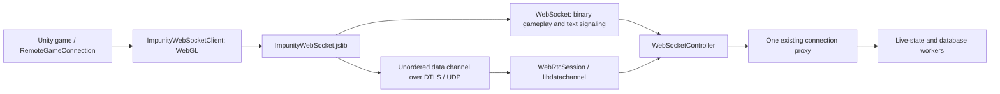

# WebRTC transport for Unity WebGL

Status: implemented. Reviewed against the repository on 2026-11-14. The standalone server, native libraries for
four platforms, headless test client, and Unity WebGL bridge are present. A real Unity WebGL build is confirmed
working in Chromium. Network impairment, NAT, Firefox/Safari, and capacity validation remain outstanding.

This document describes the current transport and its limits. The [connection guide](../guides/Connections.md)
covers the logical connection; the [distributed entity guide](../guides/DistributedEntities.md) covers the
replication model; the [swarm demo guide](../../ImpunityUnity/docs/SwarmDemo.md) covers exercising and measuring it.

## 1. Purpose and contract

Impunity keeps a WebSocket connection for reliable traffic and adds one optional, bidirectional WebRTC data
channel for unguaranteed entity updates such as movement and aim. Every peer connection terminates at the
standalone ASP.NET server through libdatachannel. The server relays state through the existing channel
subscriptions; clients do not connect directly to one another.

The channel is unordered with zero retransmissions. A lost update does not have to be retransmitted before a
later update is delivered. This remains SCTP over DTLS with congestion control and buffering, not raw UDP or a
delivery-time guarantee.

WebSocket is the lifetime owner and fallback. `Connect` completes through the ordinary Impunity handshake and
clock sync without waiting for WebRTC. If the optional channel is unavailable, later unguaranteed sends use
WebSocket. An open but congested channel drops updates rather than moving its backlog onto the reliable path.
Losing WebRTC does not disconnect the game or fail its pending reliable actions.

The production client implementation is Unity WebGL. Native Unity clients retain TCP/UDP or WebSocket;
`RtcWebSocketTestClient` is a headless test transport, not a shipped native-client API. There are no media
tracks, reliable data channels, TURN configuration, application fragmentation, or WebSocket replacement.

## 2. Replication and wire contract

The current wire-protocol version is `ImpunityConstants.ImpunityVersion = "2"`. The establish request carries
that version, and a remote server rejects a missing or different version with `ServerProtocolIncompatible`.
There is no legacy protocol path or capability-version negotiation. Game schema/rule compatibility remains a
separate check through `GameStateFormatData.Version` and its checksum.

Each data-channel message is exactly one existing Impunity frame: **12 total header bytes**, including the
four-byte total-length prefix, followed by BSON. There is no RTC-specific envelope, packet sequence, or
connection token. The native peer and its owning WebSocket supply the connection identity. See
[ImpunityNetworkingUtil.cs](../../ImpunityUnity/Assets/Scripts/Impunity/Server/Networking/ImpunityNetworkingUtil.cs).

### Delivery intent

`RemoteGameConnection.SendMessage` writes `ImpunityMessageFlags.UNGUARANTEED` (value 2) from the action's delivery
class, even if this particular send falls back to WebSocket. `GameStateActionBase.Guaranteed` itself is not
BSON-serialized. The server restores unguaranteed intent only for an `UpdateEntityAction` whose
`MayBeUnguaranteed()` returns true: no requested reply, known-field guard, conditional action, or update note.
Other actions retain guaranteed delivery.

This lets a writer using WebSocket fallback still reach another client's working data channel. Every recipient
selects its own transport. Reliable dirty fields and update extras continue to force reliable sends. Database
operations, subscriptions, entity creation/deletion, events, locks, guarded operations, notes, and action replies
use the reliable path in normal client operation.

### Freshness

Entity update sequences are `uint`: client `SendSeq`, wire `Seq`, server `RecvSeq`/`OutSeq`/`LastModSeq`, and
client `FieldRecvSeq`. `ImpunityUtil.NextSeq` skips zero, which means no sequence. `SeqIsNewer` uses a signed
32-bit difference; its ordering window is less than 2^31 increments (about 414 days at 60 updates/second for one
entity). Guard blobs use `[fieldId: byte][seq: uint little-endian]...[0]`.

The server's `ApplyProps` checks each field against the last sequence from that field's last writer. It applies
and stamps accepted fields, excludes stale fields from the relayed bytes, and leaves their `LastModSeq`
unchanged. A wholly stale property update without a note produces no relay and does not advance `OutSeq`.
Listeners compare the server's broadcast sequence per field. This preserves fresh fields in a partly stale
message rather than dropping the whole message. Notes can require a relay even without accepted fields.

There is no ordering between WebSocket and the data channel. An update can overtake creation or arrive after
deletion; unknown entities do not acquire state from those packets. The implementation uses existing entity
IDs, snapshots, and sequences, not separate incarnation tokens. The sequence checks have a finite comparison
window and do not establish a global order between different writers.

Games should use unguaranteed delivery for independently useful replacement values, send fresh samples
regularly, and finish movement with a guaranteed value when convergence matters. Use `force: true` if the final
value equals the local value and dirty tracking would otherwise suppress it. Lost samples are not replayed by
the transport.

## 3. Architecture and ownership



WebRTC is a private detail of the WebSocket transport, much as the UDP socket is a private detail of the TCP
transport. One browser has one logical connection, one proxy, and one world authorization. The shared runtime
selects paths through `SupportsUnguaranteed` and `MaxUnguaranteedMessageBytes`, not WebRTC-specific APIs.

Both transport interfaces distinguish reliable and datagram receives with `OnMessageRecieved` and
`OnUnguaranteedMessageRecieved` (the spelling is the existing API). This distinction keeps optional-path traffic
from extending the reliable connection's silence deadline. TCP/UDP uses the same split.

| Component | Responsibility |
| --- | --- |
| [WebSocketController](../../ImpunityStandaloneServer/src/controllers/WebsocketController.cs) | Owns the socket and optional session; separates text signaling from binary frames; serializes socket sends. |
| [WebRtcService](../../ImpunityStandaloneServer/src/webrtc/WebRtcService.cs) | Singleton for native availability, configuration, peer/channel callback routing, admission checks, and periodic liveness ticks. |
| [WebRtcSession](../../ImpunityStandaloneServer/src/webrtc/WebRtcSession.cs) | One peer and one channel; answer generation, sends, health clocks, and asynchronous deletion. |
| [LibDataChannelNative](../../ImpunityStandaloneServer/src/webrtc/LibDataChannelNative.cs) | Version-specific C interop, platform selection, manifest/hash validation, and library loading. |
| [ImpunityWebSocketClient](../../ImpunityUnity/Assets/Scripts/Impunity/Client/Networking/ImpunityWebSocketClient.cs) | Managed WebGL transport; exposes channel availability and bridges copied frames into the shared runtime. |
| [ImpunityWebSocket.jslib](../../ImpunityUnity/Assets/Plugins/ImpunityWebSocket.jslib) | Owns browser WebSocket/peer/channel objects, signaling, timers, retry, and WASM transfers in one instance registry. |

Native code and ASP.NET integration stay in the standalone project. The shared runtime remains
`netstandard2.1`; native interop is not shipped inside Unity's plugins. Native callbacks copy data into managed
memory and route through the existing receive/parser path; game-state work is queued to the live worker, and
client action application/callbacks occur through `RemoteGameConnection.Update()`.

## 4. Signaling and establishment

Signaling uses JSON **text messages on the existing WebSocket**. Binary messages remain Impunity frames. Text
messages never enter the action factory or game-state queues. Availability is learned from the answer or a
refusal in response to an offer; it is not advertised in `EstablishConnectResult` or a separate capability push.

```text
browser                                         standalone server
   |-- WebSocket opens --------------------------->|
   |-- binary Impunity establish ----------------->|  normal logical connection
   |-- text {"t":"offer","sdp":"..."} ------------>|  optional negotiation in parallel
   |<- text {"t":"answer","sdp":"..."} ------------|  complete server candidates
   |      or {"t":"unavailable","r":"..."}         |
   |=== ICE / DTLS / SCTP over UDP =================|
   |    each local channel-open event enables sends |
```

The browser creates `RTCPeerConnection({ iceServers: [] })` and
`createDataChannel("impunity", { ordered: false, maxRetransmits: 0 })`. It sends its offer as soon as
`setLocalDescription` resolves; it does not wait for candidate gathering or send trickled candidates.

The server removes `a=candidate` and `a=end-of-candidates` lines from the offer. It learns the browser's remote
address through the browser's incoming ICE connectivity check as a peer-reflexive candidate. This avoids
requiring the server to resolve browser mDNS host candidates or initiate checks to client-supplied candidate
addresses. It still depends on the browser reaching a server candidate; it does not solve blocked UDP.

libdatachannel auto-negotiation generates the answer after the remote offer is set. The server waits for its
local gathering-complete callback, up to five seconds, then reads the full description. No local candidates
means failure. If configured, it adds a `public_address` host candidate on the same `udp_port`; fingerprints and
ICE credentials are left intact. There is no trickle exchange, activation handshake, or offer/attempt ID.

The server adopts one incoming channel and checks `unordered`, `unreliable`, zero retransmits, and zero
packet-lifetime limit. Extra channels are deleted. It does not validate the channel label or subprotocol.
Each endpoint enables sending on its own channel-open event; reliable connection establishment remains
independent. Before the game connection has a server and connection replicant, datagram gameplay is dropped.

### Refusals and limits

| `r` value | Meaning |
| --- | --- |
| `disabled` | Server configuration disables WebRTC. |
| `unavailable` | Native service cannot operate, or peer creation fails. |
| `full` | The peer-count check reaches `max_peers`. |
| `busy` | This socket already has an offer being answered. |
| `failed` | The offer cannot be answered, including invalid SDP or gathering failure. |

An SDP string over 16,384 characters is rejected by `AnswerAsync`; the outer message is subject to the
controller's receive buffer. Only one offer is answered per socket at a time. A later offer replaces its
existing session. A peer that never opens is closed after 15 seconds. Admission uses a current-count check,
not an atomic capacity reservation; concurrent offers can exceed the configured count.

A 2.5-second controller deadline waits for the **first binary Impunity message**, not for successful world
authorization. Signaling does not reset it. Native negotiation can allocate a peer before authorization, and
the deadline should not be described as a complete pre-authentication resource limit.

Binary sends and signaling replies take the same `SemaphoreSlim` (`SendLock`). The proxy already serializes
its reliable writes; this extra lock coordinates them with signaling. Batched reliable frames are split into
individual WebSocket binary messages while holding the lock. The bounded socket-close handshake is a separate
shutdown path.

## 5. Sending, receiving, and buffering

| Send condition | Path/result |
| --- | --- |
| Guaranteed | WebSocket. |
| Unguaranteed, no open data channel | WebSocket fallback. |
| Unguaranteed frame larger than 1,200 bytes | Reliable path, retaining its delivery-intent flag upstream. |
| Unguaranteed, channel open, buffer at/below budget | Submit one binary frame to the data channel. |
| Unguaranteed, channel open, already buffered above 16 KiB | Drop the update. |

`ImpunityConstants.MaxUnguaranteedMessageSize` is 1,200 bytes, including the Impunity header. Both TCP/UDP and
WebSocket/WebRTC expose this limit. Client routing occurs in `RemoteGameConnection`; server routing occurs in
`ServerSideNetworkConnectionProxy.QueueMessage`, before bypassing the reliable queue. This is an application
size budget, not a guarantee that SCTP/DTLS/IP never fragments on a particular network path.

The browser checks `RTCDataChannel.bufferedAmount`; the server checks `rtcGetBufferedAmount`. These are
admission thresholds on already-buffered data, not hard total-memory limits: a send is allowed at exactly
16 KiB, lower transport buffers are not included, and the server also sends timer-driven keepalives. There is
no latest-value coalescing, application expiry queue, or replay. Zero retransmits alone does not eliminate
initial-send buffering.

Server sends that lose the race with channel closure are dropped. `SendUnguaranteedMessageAsync` never writes
to WebSocket, which could already have a reliable write in flight. A native send error is logged/dropped or
returned as failure by the native API; it does not itself close the session. Close/error callbacks and silence
detection determine fallback for later sends.

The browser bridge returns `0` after submission, `1` for an intentional budget drop, or a negative value for
missing channel/send failure. C# falls back to WebSocket for a negative result, including a synchronous JS
send exception. It does not fall back for a budget drop. Submission is not a delivery acknowledgement.

Without a per-recipient envelope, ordinary relayed updates retain encode-once fan-out: recipients share the
encoded frame. Notes force reliable delivery and have their own sender-specific representation under the
existing update-note semantics.

### Receive path

The server copies native binary data before the callback returns and hands it to
`ClientUnguaranteedMessageReceived`. It checks a minimum 12-byte frame and exact declared length, ignores
transport `KEEPALIVE`, and dispatches only `UPDATE_ENTITY` for an established replicant. The client equivalent
checks framing and dispatches only `ENTITY_UPDATE_MESSAGE`. Datagrams never refresh the reliable silence clock.
The browser consumes server channel keepalives in JS rather than forwarding them into C#.

These checks have two boundaries worth preserving explicitly:

- The 1,200-byte limit is enforced on **outgoing selection**; there is no corresponding 1,200-byte receive cap
  before native-buffer allocation/copy. Native `MaxMessageSize` is left at its default.
- The server's datagram gate restricts the message type. `MayBeUnguaranteed()` controls whether the header flag
  downgrades relay reliability; it does not reject an inbound `UpdateEntityAction` with reliable-only extras
  merely because that action arrived over the data channel. Normal clients route those updates reliably.

## 6. Liveness, fallback, and retry

Reliable and optional-path health are separate. WebSocket binary traffic and the ordinary Impunity keepalives
maintain the logical connection. RTC gameplay and channel keepalives maintain only the RTC session. Continuing
movement cannot keep a dead reliable connection alive.

| Timer/setting | Server | Browser bridge |
| --- | --- | --- |
| Check interval | 500 ms | 250 ms |
| Send channel keepalive after idle | 1 second | 1 second |
| Close open channel after receive silence | 5 seconds | 5 seconds |
| Give up without channel opening | 15 seconds | 15 seconds |
| Candidate-gathering wait | 5 seconds | No wait before sending offer |
| Retry | Client-driven | One retry after 30 seconds; successful open re-arms it |
| Clock | `Environment.TickCount64` | `Date.now()` |

Keepalives are existing header-only Impunity frames: client type 104 and server type 2, twelve bytes each.
They provide independent receive-silence checks, not an acknowledged ping/pong or an RTT estimator. RTC receipt
updates the channel-health clock before full gameplay validation.

The server closes on peer disconnected/failed/closed or channel close/error. The browser closes immediately
on peer failed/closed or channel close/error; its silence timer handles a disconnected path that does not
produce one of those events. Channel failure clears `SupportsUnguaranteed`; later sends use WebSocket.

A browser failure can schedule one retry while its WebSocket remains open. Successful channel opening clears
the retry-used flag, so a subsequent failure can earn another attempt. An explicit `unavailable` response,
including `full` or `busy`, stops that attempt without retry. Missing `RTCPeerConnection` or failure during
initial construction simply leaves WebSocket in use.

Closing/deleting the browser transport cancels timers, closes peer/channel, and removes the instance. Late
RTC handlers and Promise continuations verify that their instance still owns that peer. Server session close
is idempotent, removes callback routing, notifies its controller, and schedules native deletion on the thread
pool rather than deleting from a native callback. WebSocket loss tears down RTC; RTC loss alone does not raise
logical `OnNetworkError`. Explicit disposal does not report a spurious connection error.

Background tabs can delay timers and Unity frames. A lost channel may recover through the retry policy;
application responsiveness and continuous RTC availability while backgrounded are not guaranteed. Browser
wall-clock changes can also affect the current `Date.now()` deadlines.

## 7. Unity WebGL bridge and application API

All browser transport code lives in **one** file, `ImpunityWebSocket.jslib`, with one instance registry.
There is no separate `ImpunityWebRTC.jslib`. JS owns descriptions, signaling, native browser objects, and timers.
Managed C# registers static AOT callbacks for channel open, close, and binary receive, and reads the resulting
`RtcOpen` flag.

`ImpunityOptions.UseWebRtc` defaults to true; false suppresses the browser's attempt. Both
`MakeWebSocketClient(url)` and `MakeWebsocketRemoteConnection(url, …)` accept full `ws://` or `wss://` URLs.
The host/port overload still constructs an insecure `ws://` URL. `RemoteGameConnection.SupportsUnguaranteed`
reports whether the optional path is currently open, not its measured latency or packet-loss rate.

Buffer ownership is explicit:

- Both JS send functions accept array pointer, offset, and length. `HEAPU8.buffer.slice` copies the specified
  segment before returning, so later WASM buffer reuse or growth cannot mutate a pending send.
- Incoming binary messages are copied into temporary `_malloc` memory, passed to C#, and freed in `finally`.
  C# copies into a managed byte array before queuing further work.
- The bridge sets `binaryType = "arraybuffer"`. Text signaling stays in JS.
- Values in `$impunityWsState` must survive Emscripten emitting the object as text. The keepalive template is a
  plain array converted to bytes at send time, not a typed array stored in the initial object.

The WebGL C# branch can compile headlessly through
[ImpunityUnityWebGLRuntime.csproj](../../ImpunityRuntime/ImpunityUnityWebGLRuntime.csproj). Actual Unity WebGL
builds additionally exercise Emscripten's `.jslib` processing, `makeDynCall`, and IL2CPP callback linkage.
`ImpunityRuntime/build.sh` distributes the combined jslib alongside the WebGL runtime.

## 8. Native library, loading, and packaging

The server owns a small C API binding pinned to **libdatachannel v0.24.6**. Builds use libjuice for ICE,
usrsctp for SCTP, and **Mbed TLS v3.6.7** for DTLS. The binding explicitly represents C booleans as bytes and uses
Cdecl callbacks. It must remain matched to the pinned `rtc.h` layout rather than a newer upstream header.

### Availability and lifetime

`Program.cs` starts TCP, then calls `WebRtcService.Start()` synchronously before building/running the HTTP app.
Expected initialization failures are caught and leave RTC unavailable; HTTP/WebSocket startup continues.
Initialization is not a background task or independently time-bounded startup operation.

The service:

1. Skips native loading when `enabled` is false.
2. Selects a library by OS and **process architecture**, from `AppContext.BaseDirectory/runtimes` or the
   `IMPUNITY_WEBRTC_RUNTIMES` override.
3. Checks the manifest's libdatachannel tag and file SHA-256, loads the absolute file with
   `NativeLibrary.TryLoad`, and installs a DllImport resolver. This verifies consistency with the supplied
   manifest, not an independently signed supply chain; other manifest fields are build metadata.
4. Probes the configured UDP bind address/port, resolves optional `public_address`, initializes native logging,
   and creates/deletes a peer as a smoke test.
5. Starts the liveness timer and reports availability. The port probe is not a reservation; actual mux binding
   occurs when a real peer gathers candidates.

Missing files, unsupported platforms, hash/tag mismatch, native loader failure, or startup port conflicts
leave the server usable over WebSocket and produce a warning. Availability is process-local and not a promise
that a particular client can reach UDP. A failed public-address lookup logs a warning and leaves only local
candidates. There is no automatic library reload.

Peers use UDP mux on the configured single port, no ICE servers, ICE-TCP off, and automatic negotiation.
Service fields root the native delegates; concurrent dictionaries map peer/channel IDs to sessions. Callback
handlers catch managed exceptions and copy borrowed data before returning. They can route receives and change
session state directly; they are not all deferred to a separate executor.

At shutdown, after `app.Run()` returns, the service stops admission/ticking, closes sessions, and invokes
`rtcCleanup` on a task with a three-second wait limit. Peer deletion is also asynchronous. That bound prevents
waiting indefinitely in this cleanup call; it does not prove all concurrent teardown work has completed or
bound ASP.NET's earlier shutdown. A native crash can terminate the process and cannot be converted to ordinary
managed fallback.

### Build artifacts

[build.sh](../../native/libdatachannel/build.sh) builds the current platform; the
[native workflow](../../.github/workflows/native-libdatachannel.yml) runs it on four runners, smoke-tests the
results, and optionally commits them. Binaries and manifests are committed under
[ImpunityStandaloneServer/runtimes](../../ImpunityStandaloneServer/runtimes), so ordinary managed builds do not
rebuild or download the native stack.

| Target | RID | Workflow runner | Library | Native manifest floor |
| --- | --- | --- | --- | --- |
| macOS Arm64 | `osx-arm64` | `macos-15` | `libdatachannel.dylib` | macOS 12.0 |
| Linux Arm64 | `linux-arm64` | `ubuntu-22.04-arm` | `libdatachannel.so` | glibc 2.34 |
| Linux x86-64 | `linux-x64` | `ubuntu-22.04` | `libdatachannel.so` | glibc 2.34 |
| Windows x86-64 | `win-x64` | `windows-2022` | `datachannel.dll` | Windows 10 |

The native floor is not the whole application's OS support policy: the .NET 10 runtime must also support the
host. Musl/Alpine, macOS x64, and Windows Arm64 have no matching supported native build and use WebSocket
fallback. A matching CPU alone does not make a glibc binary usable on musl.

Each artifact is one shared library with libjuice, usrsctp, and Mbed TLS statically linked. Linux also links
the C++ runtime statically; Windows uses the static C runtime. The script checks dynamic dependencies against
system-library allowlists and records dependencies, platform floor, flags, pins, and SHA-256 in
`libdatachannel.manifest.json`.

Pins are checked as both tags and commits:

- libdatachannel: `v0.24.6`, `6b1e2e620f1e37f0eafeee702eaea0043cb305fd`.
- Mbed TLS: `v3.6.7`, `068ff080b369adfac81509f9b57b2afabaf82dc5`.

The build disables media, libdatachannel's own WebSockets, examples, and upstream tests; selects Mbed TLS and
libjuice; and builds shared libdatachannel with static dependencies. It enables `MBEDTLS_SSL_DTLS_SRTP` because
the selected libdatachannel DTLS code requires that API even in a data-only build. The workflow's
[smoke.py](../../native/libdatachannel/smoke.py) loads each library, creates a peer and data channel, reads an
offer containing a certificate fingerprint, and deletes the objects. This is distinct from a browser
interoperability or impaired-network test.

The standalone csproj copies `runtimes/` to build and publish outputs; its build script copies that directory
to `bin/StandaloneServer/`. Native libraries do not go in Unity's `Assets/Plugins`.

On macOS the library is ad-hoc signed, not Developer ID signed/notarized. A quarantined copy may fail to load;
the loader includes a quarantine-removal hint. After verifying the provenance of an affected checkout, the
repository-relative command is:

```bash
xattr -dr com.apple.quarantine ImpunityStandaloneServer/runtimes
```

For a copied server distribution, apply the command to that distribution's `runtimes` directory. Public macOS
release signing/notarization and bundled third-party notices are outstanding packaging work. The native
artifact directories currently contain binaries/manifests, not the dependency license/notice bundle. Static
bundling also makes rebuilding dependency security fixes part of maintaining this transport.

## 9. Certificates and deployment

WebRTC uses certificates generated by the browser and libdatachannel. Their SDP descriptions carry DTLS
fingerprints; the DTLS implementations authenticate the presented peer certificates against those descriptions.
A separate public CA certificate is not provisioned into libdatachannel. Neither the bridge nor the P/Invoke
adapter disables fingerprint verification or ships private keys to the other endpoint.

HTTPS/WSS has a different role: it authenticates the page and signaling endpoint that supplies those
fingerprints. Production deployments should serve the game over HTTPS and connect using WSS with a normally
trusted certificate. Plain WS does not authenticate fingerprint exchange against an intermediary. The server's
current `Program.cs` binds HTTP; a public TLS endpoint/reverse proxy is a deployment responsibility. The
`server_hostname` CORS setting is not an explicit WebSocket `Origin` allowlist in the controller.

The server needs a reachable UDP port in addition to HTTP/WSS:

| Setting in `webrtc` | Default | Meaning |
| --- | --- | --- |
| `enabled` | `true` | False skips native loading and refuses RTC offers. |
| `udp_port` | `29656` | Single multiplexed RTC UDP port. |
| `bind_address` | null | Local IP to bind; null probes/binds the default interface configuration. |
| `public_address` | null | Public IP or hostname to add as a candidate on the same UDP port. |
| `max_peers` | `256` | Peer-count admission threshold, subject to concurrent creation races. |

Omitting the entire object uses defaults. Configuration is in
[ServerConfig.cs](../../ImpunityStandaloneServer/src/ServerConfig.cs). For example, this fragment enables RTC on
an operator-supplied public address:

```json
{
  "webrtc": {
    "enabled": true,
    "udp_port": 29656,
    "public_address": "203.0.113.7",
    "max_peers": 256
  }
}
```

`203.0.113.7` is an example address, not a usable service endpoint. A hostname is resolved once at startup and
the first returned address is used. The implementation adds one public host candidate; it does not discover
NAT mappings, provide a different external-port setting, or act as a TURN relay. Forward the same UDP port to
the instance when using this configuration behind NAT.

UDP 29656 is separate from Impunity's TCP/UDP transport on 29654 and discovery's default client port 29655.
A reverse proxy terminating WSS does not automatically forward RTC UDP. Containers/firewalls need the UDP rule,
and a load balancer must direct UDP to the process that owns the WebSocket session. Local candidate gathering
without an external STUN service still uses ICE/STUN connectivity checks between endpoints.

No TURN or ICE-TCP fallback is configured. Networks that cannot reach a server UDP candidate keep using
WebSocket. `public_address` injection is tested as SDP construction; successful traversal through an actual
cloud NAT is a separate, outstanding validation.

## 10. Tests, demo, and evidence

The headless client in
[RtcWebSocketTestClient.cs](../../ImpunityTests/Host/RtcWebSocketTestClient.cs) combines `ClientWebSocket` and a
libdatachannel peer. It compiles the server's binding as source, which is why that binding retains C# 9 and a
block namespace. Counters distinguish channel sends/receives from socket updates; `Blackhole` suppresses
application-level channel traffic to exercise silence fallback. It does not simulate packet loss inside SCTP.

| Coverage | Evidence in the repository |
| --- | --- |
| Signaling/native refusal | [WebRtc_Standalone](../../ImpunityTests/Host/WebRtc_Standalone.cs): candidates/fingerprint/public-address construction, disabled service, missing library, port conflict, bad offer, sequential peer-limit refusal. |
| Logical transport behavior | [TransportSuite_StandaloneRtc](../../ImpunityTests/Host/TransportSuite_StandaloneRtc.cs): inherited transport battery against the real standalone process with RTC open. |
| Data-channel routing/fallback | Upstream/downstream/echo over RTC, guaranteed and oversized updates over sockets, idle keepalives, application blackhole fallback, explicit channel closure, and disabled-server fallback. |
| Shared sequencing | `IntegrationTests` category `Sequence`: dormant-field progress and partly/wholly stale updates, including guard consistency after filtering. |
| Existing UDP path | [UnguaranteedDeliveryTests](../../ImpunityTests/UnguaranteedDeliveryTests.cs): real loopback UDP relay and oversized reliable fallback. |
| Native build matrix | Four committed binary/manifest pairs and per-runner native smoke steps in the native workflow. |
| Built browser client | Real Unity WebGL swarm demo confirmed in Chromium, including JS/IL2CPP callbacks, dynamic transport status, and mixed-client replication. |

From the repository root:

```bash
./test.sh --filter "Category=WebRtc"
./test.sh --filter "Category=Sequence|Category=Unguaranteed"
./test.sh
```

The focused combined WebRTC/Sequence/Unguaranteed run on the review host (macOS Arm64) passes **58 tests, with
no failures or skips**. This does not establish current results on the other three server targets or repeat
the Unity/browser validation. The available workflow builds/smoke-tests native artifacts; it is not a
four-platform execution of the entire managed transport suite.

### Swarm demo and measurement

The [swarm demo](../../ImpunityUnity/docs/SwarmDemo.md) runs in the editor, a native macOS build, and Unity WebGL.
Each client sends replacement motion state on a known curve; recipients display the received position, the
expected position, and age-of-applied-state percentiles. WebGL can share the arena with TCP/UDP and
WebSocket-only clients. The server's inspection label `remote+udp` denotes an available unguaranteed path,
including WebRTC; it is not evidence that the browser uses the raw UDP transport.

From `ImpunityUnity/`:

```bash
tools/demo-server --web              # serve the existing WebGL build and start the demo server
tools/demo-server --web --no-webrtc  # WebSocket-only comparison
tools/demo-server --public <address> # advertise a reachable UDP address
```

The WebGL build exposes `window.impunityDemo.status`, `.run(line)`, and `.results`. See the demo guide for Unity
build commands and client controls.

Recorded Chromium WebGL validation uses Unity 6000.3.28f1 and a local standalone server. With 16 movers at
30 Hz each and 60 fps rendering, the reported browser age was approximately p50 24 ms / p99 25 ms; a
WebSocket-only editor recipient was approximately p50 27 ms / p99 30 ms. These are local smoke measurements,
not a controlled demonstration of WebRTC's advantage. Sampling/application frames and client server-clock
estimates contribute to the result. The clock-sync implementation measures RTT at the transport and favors
low-RTT samples; it does not eliminate clock error.

## 11. Remaining validation and limits

The architecture supplies the intended optional transport without a second game-state protocol. Its practical
benefit under loss, its deployment reach, and its resource bounds need separate evidence.

| Area | Current boundary / remaining work |
| --- | --- |
| Loss and jitter | Channel settings are correct and loopback delivery works. Measure state-age tails under controlled packet loss, delay, burst loss, and bandwidth contention against WebSocket-only. A test client's application blackhole is not this test. |
| Browser coverage | Real Unity WebGL is confirmed in Chromium. Firefox and Safari remain unvalidated. |
| NAT and addressing | Candidate-less offers and injected public candidates work in local/signaling tests. Exercise actual NAT/cloud routing, IPv6, multiple interfaces, and address changes. |
| Capacity | `max_peers` uses a non-atomic count check; it is not a strict concurrent ceiling. Measure memory, native threads, buffering, and shared-port behavior under load. |
| Receive enforcement | Enforceable outgoing size/eligibility rules are stronger than the current inbound gates. A receive cap before allocation and rejection of reliable-only update extras on the datagram path remain hardening opportunities. |
| Connection admission | RTC negotiation begins before world authentication. The controller's first-binary deadline and peer-count check are not a complete authorization/rate-limiting scheme. |
| Failure concurrency | Add explicit coverage of a stalled reliable write during RTC failure, reliable-path loss while RTC continues, simultaneous offers/close, late native callbacks, and shutdown with active peers. These are not established by the existing RTC tests. |
| Buffer thresholds | The 1,200-byte message budget and 16 KiB admission threshold are fixed constants, not measured optimal values or complete memory bounds. |
| Distribution | Add the dependency notices and qualify public macOS signing/notarization. Native artifact floors and successful smoke tests do not establish every supported .NET deployment. |

These limits do not require redesigning ordinary entity replication. They define where the current behavior
is proven and where deployment or robustness claims still need tests or targeted changes.
