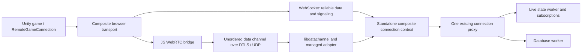

# Optional WebRTC transport for Unity WebGL

Status: proposed design; no implementation or native binaries accompany this document.

Research date: 2026-10-17. Native API baseline: libdatachannel **v0.24.6**, a candidate to pin and qualify, not a claim that its binaries have been tested here.

Quick navigation: [negotiation](#4-capability-advertisement-and-backward-compatibility), [certificates](#6-certificates-fingerprints-and-trust), [state freshness](#8-ordering-and-state-freshness-required-correctness-work), [Unity bridge](#10-unity-webgl-bridge), [native distributions](#12-native-libraries-for-the-four-server-targets), [deployment](#13-udp-deployment-ice-and-turn), [failure handling](#14-lifecycle-health-retries-and-failure-behavior), [validation](#16-validation-and-implementation-stages).

## 1. Recommendation and scope

Keep WebSocket as the required connection for authentication, database operations, subscriptions, entity lifecycle, reliable updates, keepalives, and WebRTC signaling. Add one optional, bidirectional WebRTC data channel per WebSocket connection for small unguaranteed entity updates. The standalone server terminates every WebRTC connection and continues relaying updates through Impunity's existing channel subscriptions. Clients do not connect directly to other clients.

Use the browser's `RTCPeerConnection` through a Unity `.jslib` bridge. On the standalone server, use a small managed adapter over libdatachannel's C API and ship native libraries built from pinned sources for all four required platforms. Keep native interop out of the shared Unity runtime.

This serves the intended movement/position workload: later state can arrive without waiting for retransmission of lost earlier state. It does not make SCTP equivalent to raw UDP or guarantee a maximum delivery time. WebRTC data channels use SCTP over DTLS and retain congestion control. Unordered, partially reliable delivery is part of their intended design, including game state. [RFC 8831](https://www.rfc-editor.org/rfc/rfc8831.html)

The proposed channel settings are:

```javascript
pc.createDataChannel("impunity-state-v1", {
    protocol: "impunity-state-v1",
    ordered: false,
    maxRetransmits: 0
});
```

Do not also set `maxPacketLifeTime`; these are alternative partial-reliability settings. Let DCEP negotiate the channel; do not manually assign an SCTP stream ID. There are no media tracks, camera/microphone permission requests, or media codecs. [WebRTC API specification](https://www.w3.org/TR/webrtc/)

**Fallback is part of normal operation.** If either endpoint lacks support, negotiation fails, UDP is blocked, or an established data channel fails, the logical Impunity connection stays on WebSocket. `Connect` must not wait for WebRTC. Future unguaranteed sends use the existing reliable fallback when the optional channel is unavailable. Congestion on an otherwise active optional channel is handled by dropping eligible updates, not by spilling every dropped packet into WebSocket.

Initial exclusions: WebSocket replacement, native Unity WebRTC clients, peer-to-peer mesh, audio/video, application fragmentation, reliable data channels, in-place SDP renegotiation, mandatory TURN hosting, hot-loading replacement native libraries, and a custom ICE/DTLS/SCTP implementation. Existing TCP/UDP clients remain supported.

## 2. Current repository integration points

The [connection guide](../guides/Connections.md) and [distributed entity guide](../guides/DistributedEntities.md) describe the application model. Source inspection identifies these relevant boundaries:

| Current component | Relevant behavior and proposed change |
| --- | --- |
| [ImpunityWebSocketClient.cs](../../ImpunityUnity/Assets/Scripts/Impunity/Client/Networking/ImpunityWebSocketClient.cs) | WebGL callbacks already bridge JS into C#. Extend the browser transport to own an optional peer connection alongside its WebSocket. The non-WebGL WebSocket implementation may remain reliable-only. |
| [ImpunityWebSocket.jslib](../../ImpunityUnity/Assets/Plugins/ImpunityWebSocket.jslib) | Existing instance registry and WASM buffer-copy pattern provide the starting point for the new bridge. |
| [RemoteGameConnection.cs](../../ImpunityUnity/Assets/Scripts/Impunity/Client/Connection/RemoteGameConnection.cs) | Selects guaranteed/unguaranteed sends and dispatches received work during `Update()`. Add capability negotiation and reliable transport-control messages without exposing native types. |
| [BaseGameConnection.cs](../../ImpunityUnity/Assets/Scripts/Impunity/Client/Connection/BaseGameConnection.cs) | `OnHandshakeAccepted` runs before clock sync. It can record capabilities, but optional negotiation should start only after successful logical connection establishment. |
| [WebsocketController.cs](../../ImpunityStandaloneServer/src/controllers/WebsocketController.cs) | Currently the server client context itself; `SupportsUnguaranteed` is always false. Refactor transport/session ownership into a composite context while retaining the `/ws` endpoint. |
| [ImpunityServer.cs](../../ImpunityUnity/Assets/Scripts/Impunity/Server/Networking/ImpunityServer.cs) | Per-client reliable queues already isolate slow clients. Unguaranteed sends bypass them. Extend routing so optional-transport refusal cannot cause concurrent WebSocket writes. |
| [GameStateClientActions.cs](../../ImpunityUnity/Assets/Scripts/Impunity/Server/GameState/GameStateClientActions.cs) | Contains establish request/result and entity update payloads. Add optional capability and sequencing fields. |
| [GameStateServerActions.cs](../../ImpunityUnity/Assets/Scripts/Impunity/Server/GameState/GameStateServerActions.cs) | Contains downstream replication and snapshot messages; extend their optional sequencing metadata. |
| [GameStateLive.cs](../../ImpunityUnity/Assets/Scripts/Impunity/Server/GameState/GameStateLive.cs) | Applies and relays entity updates. Correct stale-field relaying before enabling another unordered path. |
| [ClientEntityManager.cs](../../ImpunityUnity/Assets/Scripts/Impunity/Client/Connection/ClientEntityManager.cs) | Applies per-field sequence checks and seeds snapshots. Extend those checks consistently across both transports. |
| [ServerConfig.cs](../../ImpunityStandaloneServer/src/ServerConfig.cs) and [Program.cs](../../ImpunityStandaloneServer/src/Program.cs) | Own configuration and service lifetime. Add an optional WebRTC service and deployment settings. |
| [build.sh](../../ImpunityStandaloneServer/build.sh) | Copies a fixed list of files today. Packaging must move to complete RID-specific publish outputs so native/transitive assets are included. |

The actual frame layout is **12 total header bytes**, including the four-byte length prefix, followed by BSON. It is not a four-byte prefix plus another twelve bytes. The authoritative layout is in [ImpunityNetworkingUtil.cs](../../ImpunityUnity/Assets/Scripts/Impunity/Server/Networking/ImpunityNetworkingUtil.cs). Preserve that layout inside RTC messages.

Shared changes must remain `netstandard2.1` compatible. Native loading, P/Invoke, and ASP.NET hosting belong under `ImpunityStandaloneServer`, outside its glob of shared server sources. This design works with the current .NET 10 server and does not depend on .NET 11.

## 3. Architecture and ownership



Each browser has exactly one logical connection proxy, one connection ID, and one world authorization. Its optional RTC session is owned by that WebSocket context. Never create a second game connection, repeat `EstablishConnectionAction` over RTC, or look up authority using a client-supplied connection ID.

Introduce three standalone-only responsibilities:

* `WebRtcService`: native availability, process-wide limits, configuration, startup/shutdown, and session creation.
* `WebRtcSession`: one peer connection and one data channel, bound to the owning WebSocket context and a negotiation attempt ID.
* `LibDataChannelNative`: version-matched C interop, native ownership, callbacks, and loading diagnostics.

Use a small optional shared transport interface for capability discovery, activation, and typed send outcomes. Shared code must know only about an optional unguaranteed transport, not libdatachannel or ASP.NET. Keep the existing transport interfaces usable by TCP, local tests, and third-party implementations; prefer an additional optional interface to adding mandatory members everywhere.

All inbound RTC gameplay messages enter the same validation and live-state action queue as WebSocket messages, using the existing connection proxy as their origin. Native callbacks never mutate entities, execute database work, or invoke game callbacks directly.

## 4. Capability advertisement and backward compatibility

Use additive BSON fields in the existing establish request and result. The following names are proposed protocol names, not implemented members:

| Message | Optional addition |
| --- | --- |
| Establish request | `TransportCapabilities`: versions understood by this browser build, including `webrtc-state-v1` and `replication-sequence-v2`. |
| Successful establish result | `WebRtc`: `{ available, version, maxMessageBytes, negotiationTimeoutMs, reason }`. Missing means unavailable. |

Advertise `available=true` only when the client offered both required versions, the native service is usable, deployment policy permits RTC, and the connection is eligible. The server can advertise a coarse negative reason such as `disabled`, `unsupported-platform`, `native-unavailable`, or `capacity`. Do not send paths, native loader errors, or ICE credentials in public status endpoints.

Availability means the server can attempt a connection; it does not promise that the client's network permits UDP. Capacity must be checked again when an attempt starts. Do not reserve a native peer for every idle WebSocket simply because the capability was advertised.

Set an explicit `SessionEstablished` authorization state only after the normal world/password/schema handshake succeeds. `GameServer != null` is insufficient: the current proxy assigns it before all handshake checks finish. A migration offer must not activate RTC; defer until migration completes and the world is usable. Failed/declined migration follows the existing connection semantics.

Compatibility rules:

* New client, old server: absent result capability means WebSocket-only; no unknown control messages are sent.
* Old client, new server: absent request capability means WebSocket-only; no unsolicited RTC messages are sent.
* New peers, native library missing: ordinary handshake succeeds with unavailable status.
* TCP or non-browser WebSocket clients: do not advertise browser RTC capability unless their implementation supports it.
* Unknown capability versions: negotiate only the exact supported version, otherwise use WebSocket.

Verify the actual UltraLiteDB mapper ignores unknown optional BSON fields using old/new serialized fixtures. Do not infer wire compatibility merely from a field being nullable in C#. Transport negotiation is independent of the game's schema version/checksum; it must not trigger a save-game migration.

## 5. Signaling protocol over the existing WebSocket

Use new **binary framed transport-control message types** with BSON bodies on the existing reliable send path. Do not introduce a second signaling HTTP endpoint or interleave ad hoc WebSocket text writes from native callbacks.

Reserve direction-specific control type IDs after checking the current enum ranges. These are intercepted by a narrow transport-control dispatcher before ordinary action factory lookup. They are not DB actions, cannot run conditionally, carry no action correlation ID, and cannot satisfy an application request callback. Use message ID zero and the no-reply flag. Register their encoders/decoders explicitly rather than allowing arbitrary polymorphic action deserialization.

Every control message carries the negotiated protocol version and a server-issued, cryptographically random 128-bit `attemptId`. `Begin` is the one client request without an attempt ID; the server replies `BeginAccepted` with the ID and limits. Store IDs as 16 bytes or a canonical base64 string, never as a JavaScript Number.

| Control | Direction | Purpose |
| --- | --- | --- |
| `Begin` | Client → server | Request an optional session after normal connection success. |
| `BeginAccepted` / `Unavailable` | Server → client | Allocate an attempt and return approved ICE configuration, or decline without failing the game connection. |
| `Offer` | Client → server | Browser-generated SDP. Browser is always the offerer. |
| `Answer` | Server → client | libdatachannel-generated SDP. Server is always the answerer. |
| `Candidate` / `CandidatesComplete` | Both | Trickle ICE candidate, MID, and gathering completion. |
| `Ready` | Both | Local data channel opened and its parameters were validated. |
| `Activate` / `Activated` | Server → client / client → server | Enable gameplay routing after both peers are ready. |
| `Disable` | Both | End this attempt, report a bounded reason, and revert subsequent sends to WebSocket. |

Proposed establishment sequence:

1. Complete WebSocket, Impunity handshake, and clock sync. Report the normal `Connect` callback without waiting for RTC.
2. If browser support and server advertisement both permit it, send `Begin`. The server validates authorization, migration state, limits, and native availability.
3. After `BeginAccepted`, the browser creates a peer and the specified channel, installs handlers, creates an offer, and sets its local description. Send the offer before releasing queued local candidates.
4. The server applies the remote offer and generates its answer using an explicit negotiation mode. Do not combine manual answer generation with libdatachannel auto-negotiation and emit duplicate answers.
5. Exchange candidates. Queue bounded early candidates until the matching remote description has been applied; flush in order. Treat end-of-candidates as a control state even if the native API does not have an identical empty-candidate call.
6. Server accepts exactly one incoming data channel with the expected label, protocol, unordered mode, and zero retransmissions. Reject extra channels and media offers. Browser validates its resulting channel parameters too.
7. Both peers send `Ready` after their local open event. The server sends `Activate` only after receiving both ready conditions. Client sends `Activated`, then enables RTC gameplay sends; server enables its own sends when it receives that acknowledgement.
8. Receive gates open at local-ready time for the current authorized attempt. This avoids dropping valid packets that race ahead of `Activated` on the other transport. Sending still follows the activation sequence.

Offer/answer descriptions already contain ICE credentials and certificate fingerprints. Preserve descriptions generated by the WebRTC implementations; do not hand-author or rewrite their cryptographic fields. Trickle ICE and SDP exchange are standard signaling responsibilities outside the WebRTC transport itself. [WebRTC peer connections](https://webrtc.org/getting-started/peer-connections)

Proposed control limits: one attempt per connection at a time; 32 KiB SDP; 2 KiB per candidate; 64 candidates per peer per attempt; 128 KiB total pending candidate data; 15-second negotiation deadline measured monotonically. Validate the full BSON frame against the existing message maximum as well. Ignore stale attempt IDs without allocating state. Reject wrong-state messages and rate-limit repeated failures.

Apply process-wide and per-client attempt limits before allocating a native peer. Candidate endpoints are untrusted input that can cause connectivity checks from the server: reject multicast/broadcast targets and apply a deployment-aware address policy, allowing private/LAN candidates only where intended. Keep development loopback allowances explicit. Native ICE authentication/consent remains enabled; these application limits do not replace it.

Use the existing serialized reliable writers for **all** signaling. Client callbacks enqueue managed control messages; they do not call `WebSocket.send` independently. Server callbacks enqueue control frames through the proxy's ordinary reliable queue and backlog accounting. SDP/candidate bursts should not bypass or stall that queue. A small reserved control budget can prevent unlimited signaling allocation, but must not introduce a second socket writer.

## 6. Certificates, fingerprints, and trust

There are two separate certificate roles:

| Connection | Certificate and verification |
| --- | --- |
| HTTPS game assets and WSS signaling | Normal browser-trusted TLS certificate for the public hostname, at Kestrel or the trusted reverse proxy. |
| WebRTC DTLS | Browser/libdatachannel-generated certificate, normally self-signed; authenticated against the fingerprint received in SDP. No public CA or DNS certificate is required for this certificate. |

The fingerprint is a hash of the certificate's DER encoding, not the private key or just the public key. Use the interoperable SHA-256 fingerprint emitted in SDP. Each peer's DTLS implementation verifies that the presented certificate matches the authenticated remote description. A fingerprint mismatch must fail the RTC attempt. [RFC 8122](https://www.rfc-editor.org/rfc/rfc8122.html)

For this application, the trust chain is: browser trusts the HTTPS/WSS endpoint; the established WSS session carries the authorized offer/answer; those descriptions authenticate the DTLS peer. An attacker who can substitute signaling can substitute fingerprints. Encryption without authenticated signaling is insufficient. No separate WebRTC identity provider is needed for this client-to-server arrangement. [RFC 8827](https://www.rfc-editor.org/rfc/rfc8827.html)

Proposed certificate policy:

* Let the browser and libdatachannel generate their certificates/keys; choose the default ECDSA option on the server. Do not provision a Let's Encrypt certificate into libdatachannel.
* Keep private keys inside their implementation. Never serialize them, copy them to Unity, log them, or persist them with game data.
* Exchange the full SDP over this connection's WSS session; do not trust a fingerprint supplied in an unrelated URL or cached under the user's reusable `ConnectionKey`.
* Treat certificate lifetime/cache behavior as an implementation detail. A new peer need not imply a unique new certificate. Bind every attempt using its fresh ICE credentials, SDP, and attempt ID; do not use certificate fingerprints as player IDs.
* Normal WSS certificate renewal does not require changing the RTC certificate. Process restart or RTC recreation can produce different fingerprints; accept them only through a fresh authorized negotiation.
* Do not import WebTransport's certificate-hash rules or certificate-lifetime restrictions into this protocol.

libdatachannel includes certificate generation and fingerprint code; validate the pinned backend's behavior, including long-running server operation, in qualification. [libdatachannel certificate implementation](https://github.com/paullouisageneau/libdatachannel/blob/v0.24.6/src/impl/certificate.cpp)

Require HTTPS/WSS for production by Impunity policy. Add an explicit secure WebSocket URI factory/overload: the current browser factory hardcodes `ws://host:port/ws`. Permit insecure loopback development only through an explicit development option. A self-signed WSS certificate still needs local browser trust; the separate DTLS certificate does not.

Validate the WebSocket `Origin` against configured game origins. ASP.NET CORS configuration alone is not WebSocket origin authorization. When TLS terminates at a proxy, trust forwarded headers only from configured proxies and secure the proxy-to-server hop appropriately. Authorization remains the existing world/session model; RTC does not turn Impunity into an authoritative anti-cheat server.

## 7. Gameplay messages, size limits, and transport selection

One RTC binary message contains a small transport envelope followed by **one complete existing Impunity frame**. No base64 and no concatenated batch inside an RTC message.

Proposed envelope:

| Offset | Size | Meaning |
| --- | --- | --- |
| 0 | 4 | Fixed magic identifying Impunity RTC. |
| 4 | 1 | Envelope version, initially 1. |
| 5 | 1 | Kind: gameplay, ping, or pong. |
| 6 | 2 | Reserved, zero. |
| 8 | 16 | Current attempt ID as raw bytes. |
| 24 | Remaining | One framed gameplay message, or the fixed-size probe payload. |

The attempt ID prevents late callbacks/queued packets from an old optional session entering a replacement session. DTLS authenticates packets; the envelope is a routing/lifetime guard, not a replacement security mechanism. No connection ID or password is needed on each packet.

Start with a **1,200-byte complete RTC-message cap**, including the 24-byte envelope. Thus the inner Impunity frame is at most 1,176 bytes. Negotiate the lower of configured application limits and the endpoints' effective data-channel message limits. This is a conservative application budget, not proof that every network path avoids fragmentation. Measure actual overhead, IPv6, and reduced-MTU behavior before fixing the release default.

Initial gameplay allowlist:

* Client → server: ordinary `UpdateEntityAction` explicitly marked unguaranteed, no requested result, no conditional action/correlation, no exclusive-update field snapshot, and only fields whose serialized operation is safe to lose.
* Server → client: unguaranteed `EntityUpdateMessageAction` containing eligible field state.

Guaranteed writes, DB requests, entity create/delete, subscriptions, events, locks/unlocks, exclusive updates, conditional actions, action replies, and snapshots remain on WebSocket. An entity update that includes a guaranteed dirty field remains guaranteed as a whole. Initially restrict optional delivery to replacement-value state such as movement; do not assume every collection delta is independently meaningful after a prior delta is lost.

The existing header's `NO_REPLY` flag is not a reliability flag. Also, `GameStateActionBase.Guaranteed` is marked `BsonIgnore` and defaults to true: merely feeding RTC bytes into the current receiver would lose the sender's unguaranteed intent and can make the downstream relay reliable. Add an optional `UnreliableState` boolean to the update payload, default false, populated from the sender's selected delivery class. On negotiated connections, validate the allowed action/field semantics before mapping it to the received action's `Guaranteed` value. Preserve that intent even when this particular upstream packet used WebSocket fallback, so recipients with working RTC can still benefit. Never derive it solely from `NO_REPLY` or trust it for DB/conditional/exclusive operations. Older peers missing the field keep their existing behavior.

Carry receive-path provenance internally as well (`Reliable` versus `OptionalState`) so validation and liveness accounting know which path delivered a packet. This is transport metadata, separate from the payload's intended delivery class. Use an optional receive extension or a shared internal dispatch method while preserving the existing callback contract for other transports.

Selection must happen **before** bypassing the reliable writer:

| Condition | Outcome |
| --- | --- |
| Guaranteed or ineligible | Enqueue through ordinary reliable path. |
| Optional transport unavailable/not active | Enqueue through ordinary reliable path. |
| Frame larger than negotiated RTC limit | Enqueue through ordinary reliable path; count oversize fallback. |
| Eligible, active, within budget | Try a bounded RTC submission. |
| RTC queue above budget | Drop this unguaranteed update; count congestion drop. |
| RTC fails during submission | Disable the optional path; drop the ambiguous in-flight update and route later messages reliably. |

Add a nonblocking send outcome such as `Accepted`, `Dropped`, or `Unavailable` to the optional interface. The caller must distinguish an intentional drop from a native failure. On the server, never implement oversize/error fallback by calling `Socket.SendAsync` from `SendUnguaranteedMessageAsync`: a guaranteed write may already be in flight. If a not-yet-submitted message is returned for fallback, re-enter the reliable queue without recursively selecting RTC.

On the client, `SendUnguaranteedMessage` currently has no result. Its composite implementation can perform synchronous selection and reliable fallback on the same writer/`Update()` path; asynchronous failure is a state transition for future sends. Do not fail pending guaranteed actions merely because the optional channel closed.

Ingress checks precede ordinary deserialization: binary-only; valid envelope/version/attempt; authorized receive state; inner size at least 12; inner declared length exactly equal to remaining bytes; total below both limits; allowed message type/flags; bounded valid BSON; permitted action semantics. Invalid RTC traffic must not refresh reliable-path liveness. Repeated malformed traffic can disable the optional session; existing authorization violations may still close the whole game connection.

Retain the server's encode-once fan-out optimization for the inner frame. Each recipient adds its own attempt envelope without mutating the shared bytes. RTC and WebSocket recipients may coexist in the same channel.

## 8. Ordering and state freshness: required correctness work

### 8.1 An existing relay issue must be addressed

Source inspection found that `GameStateEntity.UpdateProps` skips an older field value locally, while the channel/object overrides relay the original `propData` under a newly incremented `OutSeq`. A listener can therefore accept stale bytes as a newer server update even though the server rejected those bytes locally. This is a code-level finding, not a reproduced test result in this design exercise.

Required fix: produce relay bytes from **only accepted fields**, preserve the accepted operations' serialization semantics, and stamp `LastModSeq` consistently with the revision actually sent. If every field was rejected, send no property update. Do not stamp rejected fields as modified. Preserve the existing conditional/exclusive semantics explicitly in regression tests; do not accidentally change whether an otherwise valid no-op update counts as applied.

A packet-wide highest sequence is not enough: update 100 may contain position while update 101 contains rotation. Receiving 101 first does not make the position in 100 obsolete. Freshness remains a per-field comparison within a writer/entity lifetime.

### 8.2 Recommended negotiated sequencing extension

Current sequence numbers are 16-bit, compared with signed subtraction, and zero has special bypass/initialization behavior. Half-range comparison becomes ambiguous after 32,768 intervening sequence values; a rarely updated field on a busy entity makes this relevant even without a very long network delay. Simply skipping zero at wrap does not solve that ambiguity.

For RTC-capable sessions, require `replication-sequence-v2` and add:

* A positive BSON `Int64` writer revision on every update from that client, monotonically increasing across the entire logical connection, shared across its entities. Compare it per entity field and per authenticated writer session. Do not reset it when an entity is unsubscribed and registered again on the same connection.
* A positive `Int64` server revision per live entity, advanced for accepted broadcasts, carried on downstream updates and reliable baselines/snapshots. Maintain each recipient's per-field last accepted revision.
* An entity incarnation token assigned on live entity creation/reload, carried in reliable create/snapshot messages and subsequent updates. It changes when the same numerical entity ID represents a new lifetime, including format unload/reload.

These fields apply to **both WebSocket and RTC** for a negotiated connection. Changing transports must not reset revisions. Use integer types directly in C# and BSON; JS transports opaque bytes and must not round 64-bit revisions through Number. At the practically unreachable Int64 limit, recreate the relevant lifetime rather than wrap silently.

Keep legacy `Seq` fields for older peers. New servers can include additive metadata in the shared encoded payload for all recipients if compatibility fixtures confirm old readers ignore it; this retains encode-once fan-out. Legacy writers retain legacy sequencing limitations, but accepted updates from them receive the server's wide downstream revision. Wide freshness guarantees cannot be claimed for an old client's upstream ordering.

Extend the exclusive-update snapshot comparison coherently: negotiated peers carry wide per-field known revisions as well, while old peers retain their existing format. Mixing a wide ordinary update path with a truncated exclusive staleness check would leave a correctness hole. This is protocol work, but it is substantially smaller and more useful than creating a second replication implementation inside RTC.

### 8.3 Entity lifecycle and cross-transport races

WebSocket and RTC have no mutual delivery ordering. An RTC update may arrive before reliable creation/subscription data, or after reliable deletion/unsubscribe.

* Drop updates for unknown/unsubscribed entities; do not create entities from an RTC packet or retain an unbounded pending map.
* Reject a mismatched incarnation. Once unsubscribed/deleted, discard later packets until a reliable baseline reintroduces the entity.
* Reliable baselines seed every field's revision. A packet older than the baseline cannot roll it back; a newer packet can apply once the baseline exists.
* Recheck entity existence, current subscription, lock ownership, and world format on the live worker, not only in the network callback.
* When a format changes or migration begins, disable RTC and invalidate pending gameplay from the old format generation before unloading live state. Resume only with a fresh attempt and valid baselines.

Dropping an update that overtakes creation can lose the last movement sample. This is inherent in unguaranteed state. Games should send periodic **complete replacement values**, and send a forced reliable final value when an object stops or a durable transition matters. Document that repeated `SetUnguaranteed` of an unchanged value may need `force:true`; dirty tracking alone does not promise periodic transmission. Initial recommendation: regular movement ticks plus a reliable settling update, with optional game-level keyframes around 0.5–1 seconds. Do not silently make the transport replay an old packet to repair state.

## 9. Bounded queues and latency policy

`maxRetransmits: 0` prevents retransmission of application data; it does not prevent initial-send queues or guarantee expiration of stale queued data. Browser `bufferedAmount` exposes some sender buffering, excluding lower-level buffering. [MDN bufferedAmount](https://developer.mozilla.org/en-US/docs/Web/API/RTCDataChannel/bufferedAmount)

The native SCTP implementation also has a send queue. Its partial-reliability implementation supports retransmission-count limits, but application admission control is still needed. [libdatachannel SCTP implementation](https://github.com/paullouisageneau/libdatachannel/blob/v0.24.6/src/impl/sctptransport.cpp)

Proposed initial policy, to tune with measurements:

* No unbounded managed RTC send queue. At most 8 KiB of queued application/native-reported payload per peer, with a 2 KiB low-water mark.
* Check browser/native buffered amount plus outstanding managed submission bytes before accepting. Keep admission and native submissions serialized per session so concurrent sends cannot all pass the same budget check.
* When over budget, drop the incoming eligible message. Resume new samples below the low-water mark. Drop pending managed work older than 100 ms before native submission.
* Do not claim that the budget controls packets already inside the OS or SCTP congestion window. Measure end-to-end state age separately.
* Bound RTC ingress separately from reliable action queues, initially 64 KiB per peer plus a process-wide budget. Drop RTC work under pressure before it can starve DB/reliable actions; never retain native callback buffers.

Dropping a whole unguaranteed packet is within its contract. Arbitrary coalescing is more dangerous: keeping only the last packet for an entity can erase a field update that appears only in an earlier packet. Any future coalescing must operate on decoded replacement fields with revision checks, not opaque serialized packets or collection operations.

At 60 ticks/second, every frame of application queueing matters. Benchmark browser-event → Unity `Update()` → server live worker → recipient `Update()` latency, not just native ping time. The reliable fallback retains WebSocket's head-of-line behavior; expose that degraded mode to the application.

## 10. Unity WebGL bridge

Add an `ImpunityWebRTC.jslib` bridge beside the existing WebSocket plugin, with a shared browser-connection owner rather than separate unrelated global registries. Each entry contains the WebSocket ID, JS peer/channel objects, current attempt ID, disposal generation, candidate buffers, and bounded transport state.

The bridge needs operations for support detection, peer creation, applying descriptions/candidates, creating an offer, sending a copied binary message, querying send budget/state, and closing an attempt. Native-to-managed callbacks report local description/candidate, state changes, incoming binary data, and bounded error reasons. Use the repository's static AOT callback and instance-ID pattern.

Implementation requirements:

* Detect `RTCPeerConnection` and data-channel support with feature checks plus guarded construction. A defined API can still be disabled by policy or fail at runtime. Catch synchronous errors and every rejected Promise.
* Browser controls actual network behavior. Do not emulate UDP with JavaScript timers or assume a Web Worker eliminates Unity's main-thread scheduling delay.
* Set `binaryType = "arraybuffer"`. Copy received bytes into temporary WASM memory, invoke the managed callback, and free in `finally`; managed code copies before returning if it queues the message.
* Honor `ArraySegment.Offset` and `Count`. Existing WebSocket interop passes an array/count; the new interface must not accidentally transmit bytes preceding a segment.
* Copy outbound bytes out of WASM before any asynchronous retention. Do not hold views into `HEAPU8` across memory growth, `await`, or subsequent buffer reuse.
* Late Promise completions and event handlers must check both connection ID and disposal generation/attempt ID. Removing an instance must make subsequent callbacks harmless.
* Marshal gameplay delivery and user-visible transport-status callbacks through `RemoteGameConnection.Update()`. Native/browser transport callbacks must not reenter game code.
* Dispose cancels optional work, detaches handlers, closes channel/peer, clears candidate queues, and closes WebSocket through the existing owner exactly once.

Provide an optional status API, for example `UnguaranteedTransportStatus` plus a main-thread change callback: `WebSocketFallback`, `Negotiating`, `WebRtcActive`, and `WebRtcUnavailable(reason)`. Keep the application's existing connection/error callback semantics. An RTC failure alone is not `OnNetworkError` for the logical connection.

## 11. Server native interop and graceful unavailability

Prefer a selective C API adapter over importing a general media framework. The pinned header exposes peer/channel creation, descriptions/candidates, channel reliability inspection, binary send, buffered amount, callbacks, and deletion. Validate struct layout, C `bool` width, calling convention, UTF-8 strings, enum widths, and exported entry points against this exact header on every RID. [libdatachannel C header](https://github.com/paullouisageneau/libdatachannel/blob/v0.24.6/include/rtc/rtc.h)

Use a server-side native build/ABI manifest that identifies the libdatachannel commit, dependency commits, build options, architecture, and checksums. Do not assume an arbitrary same-named system library is ABI-compatible. Prefer resolving the exact packaged native asset from an absolute application path. Select using **process architecture**, not the host CPU; Rosetta/emulation can make them differ.

Startup sequence:

1. Start ordinary HTTP/WebSocket/TCP services independently. RTC starts as unavailable with reason `initializing`.
2. Check configuration, supported OS/process architecture, native asset manifest, and supported libc/platform policy.
3. Attempt native loading and required-export resolution. Handle missing file, missing transitive library, wrong architecture, unsupported ABI, and managed loader exceptions as optional-service failure.
4. Initialize logging and perform a bounded peer creation/description/teardown smoke test, including certificate generation and intended UDP binding where possible. Preloading alone is not proof of operational readiness.
5. Mark the provider available only after success. Log one actionable diagnostic per availability transition. All failures leave WebSocket service usable.

Do not perform loading in a mandatory static initializer or a DI constructor whose exception prevents ASP.NET startup. Avoid retrying a broken library on every connection. Re-enable after a controlled service restart; v1 does not hot-swap native code. Later resource exhaustion can decline individual attempts without taking down reliable traffic.

Keep all delegates and user-state handles alive until native deletion has finished. Copy callback payloads before returning, catch managed exceptions at every unmanaged boundary, and post work to managed queues. Native callbacks may arrive on arbitrary threads or synchronously during a native call; do not hold a lock across a native call if callbacks need it.

Use a serialized control queue per session for creation/signaling/close, on a bounded shared executor rather than one managed thread per peer. Isolate send admission from potentially blocking teardown. Never run SDP parsing, certificate creation, or peer deletion on Impunity's global network writer or live worker. A short native send may still take locks; measure it and use a bounded submission executor if it can stall unrelated clients.

Shutdown first marks sessions closed and invalidates callbacks, then closes/deletes native handles, releases managed handles after callback quiescence, and finally performs global cleanup once. Cleanup may block on callbacks and must not run from within one. `rtcPreload` has a void return and is not a successful-health-check result. [libdatachannel C API documentation](https://github.com/paullouisageneau/libdatachannel/blob/v0.24.6/DOC.md)

Expected load/configuration failures can degrade gracefully. An arbitrary native memory corruption or process crash cannot reliably be caught and converted to fallback inside the same process. An initialization timeout likewise cannot safely kill a thread inside native code: stop advertising, retain ownership of any in-flight initialization, and clean up when it returns. Strong crash isolation would require a helper process and IPC, which is outside this initial in-process design.

## 12. Native libraries for the four server targets

### 12.1 Build rather than depend on unverified prebuilds

libdatachannel supports the required OS families and offers a C API. Its license is MPL-2.0. [Upstream project](https://github.com/paullouisageneau/libdatachannel)

[DataChannelDotnet 1.3.1](https://www.nuget.org/packages/DataChannelDotnet/1.3.1) is an existing MIT-licensed .NET 9 wrapper with generated bindings. It is a candidate for a later binding audit, but its NuGet framework compatibility table does **not** establish the availability or ABI of all four native RIDs. This research did not verify a complete, maintained four-platform binary set in that package. Do not make it the production packaging assumption.

Recommendation: Impunity owns the build recipes and native artifacts, with a small matching managed adapter. A wrapper can replace that adapter later if its lifetime handling, license, native provenance, and complete RID assets pass the same qualification. Do not assemble four unrelated downloads built against different libdatachannel versions.

Use v0.24.6 as the initial qualification candidate, pinning its full commit and submodules. The release includes DTLS startup and shutdown-related fixes relevant to this work. Re-check upstream fixes before shipping rather than treating the design's version as permanent. [v0.24.6 release](https://github.com/paullouisageneau/libdatachannel/releases/tag/v0.24.6)

### 12.2 Build matrix

| Required target | .NET RID | Build approach | Artifact | Initial qualification environment |
| --- | --- | --- | --- | --- |
| macOS Arm64 | `osx-arm64` | Apple Silicon runner, Apple Clang/CMake, explicit arm64 deployment target | `libdatachannel.dylib` plus required install-name aliases | macOS 15 or later supported release; test actual minimum target |
| Linux Arm64 | `linux-arm64` | Native arm64 Linux runner/container, pinned GCC/CMake toolchain | `libdatachannel.so` and required SONAME links/files | Ubuntu 22.04 baseline; qualify newer supported Ubuntu and Debian separately |
| Linux x86-64 | `linux-x64` | Native x64 Linux runner/container with the same baseline/toolchain policy | `libdatachannel.so` and required SONAME links/files | Same distro policy as arm64 |
| Windows x86-64 | `win-x64` | Windows x64 runner, MSVC/CMake, consistent CRT policy | `datachannel.dll` | Windows Server 2022 and Windows 11 x64 initially |

These are proposed qualification baselines, not tested support claims or a promise covering every .NET-supported OS. Record minimum OS, glibc, and C++ runtime requirements in each artifact. Building on a newer Linux distribution can accidentally exclude older servers. Alpine/musl is **not** covered by `linux-arm64`/`linux-x64` artifacts; disable RTC there unless separate musl builds are added. macOS x64 and Windows arm64 likewise fall back. Consult the [.NET 10 supported OS policy](https://github.com/dotnet/core/blob/main/release-notes/10.0/supported-os.md) when publishing support claims.

### 12.3 Dependency and build policy

Prefer a shared libdatachannel with statically linked libjuice, usrsctp, and pinned OpenSSL where practical. This reduces deployment files while retaining the C ABI. Use libjuice for ICE and OpenSSL for DTLS consistently across all RIDs. Removing libdatachannel's WebSocket support does not affect ASP.NET's WebSocket implementation. Upstream documents the selectable backends and data-only build. [Build instructions](https://github.com/paullouisageneau/libdatachannel/blob/v0.24.6/BUILDING.md)

Illustrative CMake configuration, not a complete cross-platform build script:

```text
-DBUILD_SHARED_LIBS=ON
-DBUILD_SHARED_DEPS_LIBS=OFF
-DNO_MEDIA=ON
-DNO_WEBSOCKET=ON
-DNO_EXAMPLES=ON
-DNO_TESTS=ON
-DUSE_NICE=OFF
-DUSE_GNUTLS=OFF
-DUSE_MBEDTLS=OFF
-DPREFER_SYSTEM_LIB=OFF
-DCAPI_STDCALL=OFF
-DCMAKE_BUILD_TYPE=Release
```

These flags come from the [versioned CMake configuration](https://github.com/paullouisageneau/libdatachannel/blob/v0.24.6/CMakeLists.txt). They do not themselves build or statically link OpenSSL: provide an explicitly pinned OpenSSL build and verify the resulting linkage. Use a separate CI build with upstream tests enabled; production artifacts need not contain tests/examples.

Platform packaging checks:

* Linux: inspect ELF dependencies and GLIBC/GLIBCXX symbol floors, use PIC static dependencies, and verify on a clean runtime container. Do not bundle glibc. Record any libstdc++ dependency or deliberate static-runtime policy.
* macOS: inspect `otool -L`, architecture, deployment target, and `@rpath`/`@loader_path` install names. No accidental Homebrew paths. Sign packaged native files consistently with the server distribution; test quarantine/hardened-runtime deployment where applicable.
* Windows: inspect PE exports/dependencies. Choose and document static CRT or the supported redistributable; use the same choice across dependencies. Do not silently require a developer machine's OpenSSL installation.
* All targets: check required C exports, ABI sizes/offsets via a small native test helper, load from a clean published folder, and perform a real browser data-channel round trip. Cross-compilation alone is not runtime qualification.

Store licenses, notices, source references/availability information, dependency versions, hashes, and build provenance with artifacts. Track updates for OpenSSL, libjuice, and usrsctp as well as libdatachannel. Static bundling simplifies installation but makes Impunity responsible for rebuilding security updates.

### 12.4 .NET distribution layout

Use either an internal native-assets package or explicit project publish assets with this logical layout:

```text
runtimes/osx-arm64/native/...
runtimes/linux-arm64/native/...
runtimes/linux-x64/native/...
runtimes/win-x64/native/...
```

Publish one server distribution per RID, copying the **whole publish output**. Test the final resolver path because RID-specific publish may flatten selected native assets. Keep native assets out of Unity's `Assets/Plugins`; the browser uses its own WebRTC implementation and ships only the JS bridge.

Support normal framework-dependent publish first. Single-file extraction, trimming, and NativeAOT need separate qualification and are not implied by successful ordinary publish. Missing native files in an otherwise valid server distribution must produce unavailable status rather than prevent startup.

## 13. UDP deployment, ICE, and TURN

Expose a dedicated UDP endpoint for RTC. Do not bind libdatachannel to the port already used by Impunity's raw UDP transport. Proposed default is UDP 29655, configurable; existing HTTP/TCP defaults remain unchanged.

For the selected libjuice backend, use UDP multiplexing and a fixed configured port (`portRangeBegin == portRangeEnd`) so many sessions can share it. Validate actual socket reuse, IPv4/IPv6, and advertised candidates under load before relying on a single firewall rule. If qualification requires a port range, expose and document that range explicitly. The C API provides UDP mux/range settings; do not assume it provides arbitrary public-address rewriting or ICE-lite server behavior. [Native configuration API](https://github.com/paullouisageneau/libdatachannel/blob/v0.24.6/include/rtc/rtc.h)

Preferred initial deployment: publicly reachable server UDP address, or tested port-preserving NAT forwarding. ICE connectivity checks still use STUN messages even when no external STUN discovery server is configured. External STUN can discover a mapped address but does not relay traffic or make a blocked UDP path work. Do not ship a hardcoded third-party STUN service as a hidden dependency.

An HTTPS reverse proxy handles WSS but does not automatically proxy ICE/DTLS UDP. Containers require UDP publishing; cloud firewalls need the UDP rule; a load balancer must route each peer's UDP to the same process that owns its WebSocket and native session. HTTP cookie stickiness alone does not accomplish UDP affinity. Prefer a per-instance public endpoint initially. Multi-instance shared UDP ingress needs a separately tested routing design.

TURN is optional. Initial acceptance requires direct UDP plus graceful WebSocket fallback, not universal traversal. If operators later enable TURN, issue short-lived per-session credentials after authorization and retain secrets server-side. Browser TURN-over-TCP/TLS may rescue connectivity on restricted networks, but can reintroduce transport head-of-line delay. Do not label every connected RTC path as low latency.

The selected native libjuice backend does not provide all the TURN TCP/TLS options exposed by the alternative libnice configuration. Browser-side relay to a public server and server-side relay are different topologies; qualify the intended topology rather than assuming both endpoints have identical TURN capabilities. [Native ICE configuration documentation](https://github.com/paullouisageneau/libdatachannel/blob/v0.24.6/DOC.md)

Collect selected candidate type/protocol where available. For the initial low-latency mode disable server ICE-TCP and prefer direct UDP. Treat an unsupported or unclassifiable path conservatively; transport-connected is not a measured latency guarantee. Test browser mDNS host candidates without requiring clients to expose private IP addresses or rewriting their SDP manually.

## 14. Lifecycle, health, retries, and failure behavior

Optional state machine:

```text
Unavailable / Disabled
          or
Eligible -> Negotiating -> LocallyReady -> Active
                |               |            |
                +---------------+------------+-> Fallback -> bounded retry

Any state + WebSocket loss/disposal -> Closed (terminal for this logical session)
```

`SupportsUnguaranteed` means **active now**, not merely compiled in or advertised. Each direction enables sending only at its activation step. Publish transitions atomically; late callbacks must never resurrect a closed session.

Keep existing reliable keepalive traffic even when all gameplay travels over RTC. Introduce a separate reliable-receive timestamp for composite sessions: RTC packets must not keep a dead WebSocket logically connected indefinitely. Conversely, ordinary WebSocket traffic does not prove RTC is healthy. Keep the same configured logical-connection timeout semantics; if that timeout is disabled, document that transport-level close/error detection still applies.

Optional RTC health probes use the same unordered channel and carry a nonce echoed in a pong. Initial proposal: probe every two seconds when no recent round-trip proof exists, consider the optional path degraded after six seconds without proof, and resume reliable fallback. A single lost packet is not failure. Measure time monotonically. Receiving gameplay only in one direction is not proof the reverse path works.

On ICE disconnection or data-channel error/close, immediately stop new RTC sends and enter fallback. On a probe deadline, invalidate the attempt and close the peer. Do not wait for native ICE timeouts while continuing to queue movement. A resumed/backgrounded browser may have delayed timers; when `Update()` resumes, recalculate deadlines, discard expired work, and reconcile RTC state without replaying queued movement.

Retry with a new peer/attempt instead of in-place ICE restart in v1. Allow at most two automatic retries after the initial attempt, at approximately 5 and 30 seconds with jitter. Reset the retry budget on a new WebSocket session or explicit application request; do not continuously retry when the server advertised disabled/unsupported/native-unavailable. Server-side limits remain authoritative.

| Failure | Required behavior |
| --- | --- |
| API absent, policy-blocked constructor, Promise rejection | Stay connected over WebSocket; report optional reason once. |
| Unsupported server RID/libc or missing/transitively missing library | Server starts normally; advertise unavailable. |
| Native certificate generation, allocation, or UDP-bind failure | Decline attempt or disable service; retain reliable connection. |
| Capacity limit | Decline this attempt; no native allocation and no game disconnect. |
| Bad/oversized signaling or wrong attempt | Reject/rate-limit; no unbounded queues or cross-session effects. |
| Fingerprint mismatch or DTLS failure | End attempt; never disable certificate checking to make it connect. |
| UDP blocked / timeout | WebSocket gameplay continues throughout; optional bounded retries. |
| Active RTC send failure | Drop ambiguous in-flight packet, fall back for future traffic. |
| Oversize update | Reliable queue fallback; no application fragmentation. |
| RTC congestion | Drop eligible samples within explicit budget policy. |
| WebSocket lost while RTC still flows | Tear down both; existing pending-action errors and entity cleanup run once. |
| User `Dispose()` | Tear down both without reporting a spurious network error. |
| Native process crash | Cannot guarantee managed fallback; crash isolation is a separate architecture choice. |

## 15. Configuration, limits, and observability

Proposed standalone configuration is a `webrtc` object; omission means `mode: auto` with safe fallback, and `mode: disabled` completely skips native loading. During initial rollout, release configurations can explicitly disable it until all qualification gates pass.

| Setting | Proposed initial value/meaning |
| --- | --- |
| `mode` | `auto` or `disabled`; no mandatory mode in v1. |
| `bind_address` | Deployment-selected local interface; no guessed external-address substitution. |
| `udp_port` | 29655, separate from Impunity UDP. |
| `ice_servers` | Empty by default; operator-approved STUN/TURN only. |
| `allowed_origins` | Explicit public game origins for WebSocket authorization. |
| `max_peers` | Explicit finite capacity, provisional 256 pending load tests. |
| `max_pending_negotiations` | 32 process-wide, one per logical connection. |
| `negotiation_timeout_ms` | 15000. |
| `max_message_bytes` | 1200, including RTC envelope. |
| `send_budget_bytes` / `send_low_water_bytes` | 8192 / 2048. |
| `receive_budget_bytes_per_peer` | 65536, with an additional global budget. |
| `probe_interval_ms` / `probe_timeout_ms` | 2000 / 6000. |

Numbers above are starting hypotheses, not benchmark-derived capacity claims. Validate ranges and relationships at startup, and disable the optional service on invalid RTC-only configuration without corrupting unrelated server settings.

Expose process availability/reason, configured RID/native version, current/negotiating peers, attempts/successes/failures by bounded reason, time to active, bytes/messages by transport, congestion drops, oversize fallbacks, stale/invalid packet drops, send/receive queue peaks, and probe RTT. Report the actual active transport to games. Avoid full SDP, ICE passwords, TURN credentials, player IDs, or IP-address labels in normal logs/metrics. Diagnostic capture should be explicit, redacted, and short-lived.

## 16. Validation and implementation stages

No tests or browser/native experiments were run for this document. The following are acceptance gates for the future implementation.

### Stage A: qualify the native/browser transport independently

Build all four RIDs from the same pinned inputs. Run clean-machine native loading and browser echo tests with the exact unordered/zero-retry channel. Test Chrome, Firefox, and Safari, including a real Safari run rather than assuming a generic WebKit test runner is identical. Record browser and OS versions. Exercise direct IPv4, IPv6, NAT, blocked UDP, mDNS candidates, and certificate mismatch.

Measure native startup, per-peer memory, thread count, teardown time, and UDP mux behavior for 1, 32, 128, and the proposed maximum peers. Verify server-to-browser partial reliability under induced loss as well as browser-to-server; a successful reliable echo is not sufficient.

### Stage B: establish compatibility and replication correctness

Add old/new establish/snapshot/update fixtures. Prove old peers receive no new control types. Verify that an unguaranteed upstream update retains that intent on downstream fan-out, including when its upstream delivery fell back to WebSocket. Reproduce and fix stale-field relay; test mixed-field reorder, duplicate packets, zero/wrap, a field dormant for more than 32,768 entity revisions, transport switching, entity ID reuse, subscription baseline races, format unload, and exclusive/conditional ordering. Introduce the negotiated wide-revision/incarnation metadata before advertising RTC support.

### Stage C: integrate signaling and fallback

Use fake optional transports for deterministic capability/state/budget tests. Cover startup with each library missing, a wrong architecture, missing transitive dependency/export, unsupported libc/RID, native creation failure, capacity exhaustion, candidate-before-SDP, stale callbacks, close during negotiation, and bounded retries. Confirm all ordinary TransportSuite legs still pass with RTC unavailable.

Specifically hold a reliable WebSocket write in flight while triggering oversized RTC fallback and RTC failure. Assert there is never a second concurrent WebSocket send and another client remains responsive. Test RTC still flowing while WSS is blackholed, and WSS still flowing while RTC is blackholed.

### Stage D: test a built Unity WebGL game end to end

Browser API tests alone do not validate IL2CPP/AOT callbacks, `.jslib` linkage, WASM memory growth, segment offsets, or Unity `Update()` scheduling. Build a test scene with moving entities, two browser clients, and a native TCP/UDP subscriber. Test relay in every direction, browser background/resume, disposal/reconnect, main-thread stalls, final reliable settling values, and malformed/oversized messages.

### Stage E: evaluate the actual latency benefit

Compare WebSocket-only with the optional transport at 30/60 Hz under controlled RTT, jitter, loss (including burst loss), bandwidth limits, and a concurrent reliable transfer. Measure p50/p95/p99 **age of applied state**, loss/drop rate, CPU, allocations, and queue sizes. Use monotonic probe RTT or controlled synchronized clocks; the current server-time estimate is not accurate enough to declare fine-grained one-way latency gains by itself.

Acceptance requires no stale rollback, bounded memory under congestion, no interference with reliable action ordering, and materially better state-age tails under loss. If those benefits are absent, revisit admission budgets and scheduling before enabling the feature by default. Real measured connection success and operational cost determine whether optional TURN is worth adding.

## 17. Decisions still requiring evidence

| Question | Proposed decision | Evidence needed before release |
| --- | --- | --- |
| Existing wrapper or local C adapter? | Local selective adapter plus owned native artifacts. | Audit a candidate wrapper only if it reduces work without weakening lifetime/packaging guarantees. |
| Which native version/backend? | v0.24.6 candidate, OpenSSL + libjuice. | Four-RID build/runtime tests, current upstream/security review. |
| One UDP port per process? | Prefer libjuice mux on configured port. | Multi-peer IPv4/IPv6, container/NAT, port collision and restart tests. |
| What is the minimum OS/libc support? | Explicit matrix in §12, graceful fallback elsewhere. | Clean-machine loading and recorded symbol/deployment floors. |
| Can existing framing remain? | Yes, inside a small RTC envelope. | Real BSON movement sizes; no need for fragmentation at chosen cap. |
| Are existing sequence checks sufficient? | No: fix stale relay and negotiate wide revisions/incarnations. | Regression coverage across both paths and exclusive updates. |
| Can send admission stay on the shared writer? | Only if measured native calls are short and bounded. | Tail latency under contention; otherwise use bounded executor submission. |
| Is TURN required? | No for initial direct-UDP plus fallback release. | Deployment success rate and latency data. |
| Are initial budgets/timeouts right? | Treat §15 values as provisional. | Network impairment, large world, background-tab, and load tests. |
| Does self-signed DTLS need operator provisioning? | No; generated certificates and authenticated SDP. | Fingerprint mismatch, rotation/restart, backend certificate-lifetime tests. |

The transport integration is tractable without implementing networking cryptography or a media stack. The substantial commitments are maintaining four native distributions and making freshness, fallback, and lifetime behavior explicit. Those are release requirements, not cleanup to postpone until after an echo demo works.
